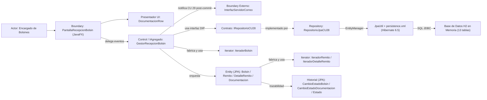
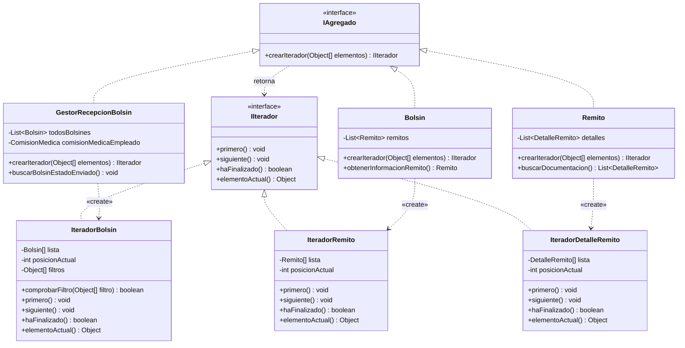

# Guía de Estudio y Defensa Práctica — CU 28: Registrar Recepción de Bolsín (`ppai-2026`)

> Guía orientada a la **presentación práctica con revisión de código en vivo** (DSI — UTN FRC). Para cada parte del caso de uso encontrarás **qué hace**, **dónde está implementado** (archivo y líneas exactas), **cómo funciona**, **por qué se diseñó así** y **qué alternativas existen**.

---

## 1. Cheat Sheet Instantáneo — "¿Dónde está implementado X?"

Usá esta tabla como índice rápido cuando el tribunal te pida abrir un método o clase en vivo:

| Qué pide buscar el docente | Archivo (link directo) | Símbolo / Líneas exactas |
| :--- | :--- | :--- |
| **Arranque y sesión inicial** | [Main.java](src/main/java/com/ppai/Main.java#L17-L19) · [JavaFxApp.java](src/main/java/com/ppai/JavaFxApp.java#L21-L56) | `Main.main` (`L17-L19`); `JavaFxApp.start` (`L21-L51`: sesión `L28-L31`, BCE `L37-L39`, inicio `L50`), `stop` (`L53-L56`: `JpaUtil.shutdown()`) |
| **Pasos 1–3: Inicio y habilitación** | [PantallaRecepcionBolsin.java](src/main/java/com/ppai/boundary/cu28/PantallaRecepcionBolsin.java#L126-L140) · [GestorRecepcionBolsin.java](src/main/java/com/ppai/controller/cu28/GestorRecepcionBolsin.java#L83-L109) | `Pantalla.tomarOpcionRegistrarRecepcionBolsin` (`L126-L129`), `habilitar` (`L134-L140`); `Gestor.tomarOpcionRegistrarRecepcionBolsin` (`L83-L109`) |
| **Pasos 4–8: Usuario logueado y su CM** | [GestorRecepcionBolsin.java](src/main/java/com/ppai/controller/cu28/GestorRecepcionBolsin.java#L114-L121) · [Sesion.java](src/main/java/com/ppai/domain/model/cu28/Sesion.java#L52-L54) · [Usuario.java](src/main/java/com/ppai/domain/model/cu28/Usuario.java#L38-L48) · [Empleado.java](src/main/java/com/ppai/domain/model/cu28/Empleado.java#L41-L43) · [PantallaRecepcionBolsin.java](src/main/java/com/ppai/boundary/cu28/PantallaRecepcionBolsin.java#L145-L159) | `Gestor.buscarUsuario` (`L114-L121`), `Sesion.getUsuario` (`L52-L54`), `Usuario.getCMEmpleado` (`L38-L40`), `Usuario.getEmpleado` (`L46-L48`), `Empleado.getCM` (`L41-L43`), `Pantalla.mostrarCM` (`L145-L159`) |
| **Patrón Iterator: Interfaces propias** | [IAgregado.java](src/main/java/com/ppai/iterator/IAgregado.java#L10-L19) · [IIterador.java](src/main/java/com/ppai/iterator/IIterador.java#L10-L42) | `IAgregado.crearIterador` (`L10-L19`); `IIterador` (`primero`, `siguiente`, `haFinalizado`, `elementoActual` `L10-L42`) |
| **1.er Agregado e Iterador (Bolsines + filtro)** | [GestorRecepcionBolsin.java](src/main/java/com/ppai/controller/cu28/GestorRecepcionBolsin.java#L124-L165) · [IteradorBolsin.java](src/main/java/com/ppai/iterator/IteradorBolsin.java#L56-L126) · [Bolsin.java](src/main/java/com/ppai/domain/model/cu28/Bolsin.java#L86-L151) · [CambioEstadoBolsin.java](src/main/java/com/ppai/domain/model/cu28/CambioEstadoBolsin.java#L61-L68) · [Estado.java](src/main/java/com/ppai/domain/model/cu28/Estado.java#L58-L60) · [ComisionMedica.java](src/main/java/com/ppai/domain/model/cu28/ComisionMedica.java#L33-L59) | `Gestor` `implements IAgregado` (`L26`), `crearIterador` (`L124-L143`), `buscarBolsinEstadoEnviado` (`L149-L165`); `IteradorBolsin.comprobarFiltro` (`L56-L85`), `primero`/`siguiente`/`haFinalizado`/`elementoActual` (`L88-L126`); `Bolsin.sosEnviado` (`L86-L105`), `esTuCMDestino` (`L108-L115`), `getNroPrecinto` (`L126-L138`), `getNombreCMOrigen` (`L149-L151`); `CambioEstadoBolsin.sosActual`/`sosEnviado` (`L61-L68`); `Estado.esEnviado` (`L58-L60`); `ComisionMedica.esTuCMDestino`/`getNombre` (`L33-L59`) |
| **Mostrar bolsines fuera del loop (corrección)** | [GestorRecepcionBolsin.java](src/main/java/com/ppai/controller/cu28/GestorRecepcionBolsin.java#L103-L108) · [PantallaRecepcionBolsin.java](src/main/java/com/ppai/boundary/cu28/PantallaRecepcionBolsin.java#L164-L238) | `Gestor` (`L103-L108`); `Pantalla.mostrarBolsines` (`L164-L200`), `mostrarNumeroPrecinto`/`mostrarCMOrigen` (`L217-L231`), `solicitarSeleccionBolsin` (`L236-L238`) |
| **Filtros A1 (precinto) y A2 (CM origen)** | [PantallaRecepcionBolsin.java](src/main/java/com/ppai/boundary/cu28/PantallaRecepcionBolsin.java#L726-L749) · [GestorRecepcionBolsin.java](src/main/java/com/ppai/controller/cu28/GestorRecepcionBolsin.java#L170-L200) | Controles UI (`L726-L749`), `aplicarFiltros` ([L839-L848](src/main/java/com/ppai/boundary/cu28/PantallaRecepcionBolsin.java#L839-L848)), `mostrarAlerta` ([L499-L508](src/main/java/com/ppai/boundary/cu28/PantallaRecepcionBolsin.java#L499-L508)); `Gestor.filtrarBolsines` (`L170-L200`: A1 `L173-L186`, A2 `L188-L197`) |
| **2.do y 3.er Agregado/Iterador (Remito y Detalles)** | [Bolsin.java](src/main/java/com/ppai/domain/model/cu28/Bolsin.java#L154-L193) · [IteradorRemito.java](src/main/java/com/ppai/iterator/IteradorRemito.java#L11-L73) · [Remito.java](src/main/java/com/ppai/domain/model/cu28/Remito.java#L32-L102) · [IteradorDetalleRemito.java](src/main/java/com/ppai/iterator/IteradorDetalleRemito.java#L12-L74) · [DetalleRemito.java](src/main/java/com/ppai/domain/model/cu28/DetalleRemito.java#L52-L60) · [Documentacion.java](src/main/java/com/ppai/domain/model/cu28/Documentacion.java#L56-L63) · [TipoDocumento.java](src/main/java/com/ppai/domain/model/cu28/TipoDocumento.java#L33-L35) | `Bolsin` `implements IAgregado` (`L34`), `crearIterador` (`L154-L171`), `obtenerInformacionRemito` (`L176-L193`); `IteradorRemito` (`L11-L73`); `Remito` `implements IAgregado` (`L32`), `getNumero` (`L63-L65`), `crearIterador` (`L68-L85`), `buscarDocumentacion` (`L88-L102`); `IteradorDetalleRemito` (`L12-L74`); `DetalleRemito.obtenerAsuntoYTipoDoc` (`L52-L60`); `Documentacion.getAsunto`/`mostrarTipoDocumentacion` (`L56-L63`); `TipoDocumento.getNombre` (`L33-L35`) |
| **Opciones 1–4, checkboxes A3/A4, regla CMC (A5)** | [OpcionRecepcion.java](src/main/java/com/ppai/domain/model/cu28/OpcionRecepcion.java#L8-L82) · [GestorRecepcionBolsin.java](src/main/java/com/ppai/controller/cu28/GestorRecepcionBolsin.java#L263-L342) · [DocumentacionRow.java](src/main/java/com/ppai/boundary/cu28/DocumentacionRow.java#L13-L74) · [PantallaRecepcionBolsin.java](src/main/java/com/ppai/boundary/cu28/PantallaRecepcionBolsin.java#L261-L332) | `OpcionRecepcion` (`L8-L82`); `Gestor.buscarOpcionesRecepcion` (`L263-L311`), `tomarSeleccionOpcion` (`L316-L342`, guardia `soloCMC` `L317-L330`); `DocumentacionRow` (`L13-L74`); `Pantalla.mostrarDatosDeRemito` (`L261-L286`), `tomarSeleccionOpcion` (`L318-L332`), `construirCardsOpciones` ([L1028-L1109](src/main/java/com/ppai/boundary/cu28/PantallaRecepcionBolsin.java#L1028-L1109), bloqueo visual `L1033-L1065`) |
| **Confirmación y A6 (no confirmar)** | [PantallaRecepcionBolsin.java](src/main/java/com/ppai/boundary/cu28/PantallaRecepcionBolsin.java#L337-L405) · [GestorRecepcionBolsin.java](src/main/java/com/ppai/controller/cu28/GestorRecepcionBolsin.java#L347-L385) | `Pantalla.solicitarConfirmacionSeleccion` (`L337-L394`), `tomarConfirmacionSeleccion` (`L403-L405`), botones Paso 3 ([L1233-L1245](src/main/java/com/ppai/boundary/cu28/PantallaRecepcionBolsin.java#L1233-L1245)); `Gestor.tomarConfirmacionSeleccion` (`L347-L385`, corte A6 `L348-L356`) |
| **Obtención de Estados + Fecha/Hora** | [GestorRecepcionBolsin.java](src/main/java/com/ppai/controller/cu28/GestorRecepcionBolsin.java#L398-L430) · [Estado.java](src/main/java/com/ppai/domain/model/cu28/Estado.java#L20-L113) | `Gestor.obtenerEstado` (`L398-L423`), `getFechaHoraActual` (`L428-L430`); `Estado` (`L20-L113`) |
| **Actualización de estados + Trazabilidad + Commit BD** | [GestorRecepcionBolsin.java](src/main/java/com/ppai/controller/cu28/GestorRecepcionBolsin.java#L435-L511) · [Bolsin.java](src/main/java/com/ppai/domain/model/cu28/Bolsin.java#L219-L255) · [CambioEstadoBolsin.java](src/main/java/com/ppai/domain/model/cu28/CambioEstadoBolsin.java#L49-L73) · [Remito.java](src/main/java/com/ppai/domain/model/cu28/Remito.java#L110-L122) · [DetalleRemito.java](src/main/java/com/ppai/domain/model/cu28/DetalleRemito.java#L68-L72) · [Documentacion.java](src/main/java/com/ppai/domain/model/cu28/Documentacion.java#L70-L117) · [CambioEstadoDocumentacion.java](src/main/java/com/ppai/domain/model/cu28/CambioEstadoDocumentacion.java#L49-L68) | `Gestor.actualizarEstadoBolsin` (`L435-L443`), `persistirRecepcion` (`L449-L457`), `actualizarRemitoYDocumentacion` (`L464-L511`); `Bolsin.marcarRecibido` (`L219-L227`), `actualizarRemitoYDocumentacion` (`L230-L236`), `crearNuevoCambioDeEstado` (`L243-L246`); `CambioEstadoBolsin` (`L49-L73`); `Remito.aceptar` (`L110-L114`), `marcarRecibidoYAceptado`/`Parcial` (`L116-L122`); `DetalleRemito.aceptar` (`L68-L72`); `Documentacion` (`aceptar` `L70-L73`, `marcarNoRecibida` `L76-L79`, `rechazar` `L82-L85`, `paraRedirigir` `L88-L91`, `cerrarCambioActual` `L93-L98`, `newCambioEstadoDocumentacion` `L105-L108`); `CambioEstadoDocumentacion` (`L49-L68`) |
| **Notificación CU 29 y Fin CU** | [GestorRecepcionBolsin.java](src/main/java/com/ppai/controller/cu28/GestorRecepcionBolsin.java#L516-L560) · [NotificacionRecepcionBolsin.java](src/main/java/com/ppai/domain/model/cu28/NotificacionRecepcionBolsin.java#L11-L94) · [InterfazServidorCorreo.java](src/main/java/com/ppai/boundary/cu28/InterfazServidorCorreo.java#L15-L23) · [PantallaRecepcionBolsin.java](src/main/java/com/ppai/boundary/cu28/PantallaRecepcionBolsin.java#L414-L478) | `Gestor.notificarRecepcion` (`L516-L549`), `finCU` (`L554-L560`); `NotificacionRecepcionBolsin` (`L11-L94`, `getCuerpoCorreo` `L79-L93`); `InterfazServidorCorreo.enviarNotificacion` (`L15-L23`); `Pantalla.informarCorrectoEnvioNotificacion` (`L414-L478`) |
| **Cancelar en cualquier momento (Obs. 1)** | [PantallaRecepcionBolsin.java](src/main/java/com/ppai/boundary/cu28/PantallaRecepcionBolsin.java#L487-L494) · [GestorRecepcionBolsin.java](src/main/java/com/ppai/controller/cu28/GestorRecepcionBolsin.java#L565-L575) | `Pantalla.cancelar` (`L487-L494`), botón global ([L613-L615](src/main/java/com/ppai/boundary/cu28/PantallaRecepcionBolsin.java#L613-L615)); `Gestor.cancelarRecepcion` (`L565-L575`) |
| **Persistencia JPA / Hibernate + H2 y Escenarios** | [IRepositorioCU28.java](src/main/java/com/ppai/repository/cu28/IRepositorioCU28.java#L14-L25) · [RepositorioJpaCU28.java](src/main/java/com/ppai/repository/cu28/RepositorioJpaCU28.java#L24-L201) · [GestorRecepcionBolsin.java](src/main/java/com/ppai/controller/cu28/GestorRecepcionBolsin.java#L580-L607) · [pom.xml](pom.xml#L41-L60) · [persistence.xml](src/main/resources/META-INF/persistence.xml#L7-L38) · [JpaUtil.java](src/main/java/com/ppai/repository/JpaUtil.java#L10-L33) | `IRepositorioCU28` (`L14-L25`); `RepositorioJpaCU28` (`inicializarDatosEscenario` `L27-L137`, `obtenerEstados` `L140-L148`, `obtenerComisionesMedicas` `L151-L159`, `obtenerTodosBolsines` `L162-L170`, `actualizarBolsin` `L173-L201`); `Gestor.cargarEscenario` (`L580-L597`), `inicializarBolsinesDeEjemplo` (`L603-L607`); `persistence.xml` (`L7-L38`); `JpaUtil` (`L10-L33`) |
| **Tests automatizados (38 tests)** | [IteratorPatternTest.java](src/test/java/com/ppai/IteratorPatternTest.java#L35-L81) · [CU28Test.java](src/test/java/com/ppai/CU28Test.java) · [PersistenciaCU28Test.java](src/test/java/com/ppai/PersistenciaCU28Test.java#L21-L210) · [MainTest.java](src/test/java/com/ppai/MainTest.java) | `IteratorPatternTest` (14 tests, reflexión cero JDK Iterator/Iterable `L35-L81`); `CU28Test` (16 tests: flujo básico + A1–A6 + Obs. 1 + regresiones); `PersistenciaCU28Test` (6 tests BD H2 real `L21-L210`); `MainTest` (2 tests) |

---

## 2. Arquitectura BCE y Principios GRASP

El proyecto implementa la arquitectura **Boundary – Control – Entity (BCE)** de DSI, combinada con un paquete dedicado para el patrón GoF **Iterator** y una capa de **Repository** conectada a **JPA / Hibernate 6.5 + H2 en memoria**:



### Responsabilidad de cada capa

- **Boundary (`com.ppai.boundary.cu28`):**
  - [PantallaRecepcionBolsin.java](src/main/java/com/ppai/boundary/cu28/PantallaRecepcionBolsin.java): interfaz JavaFX organizada como Stepper de 4 pasos que captura eventos del actor y expone los métodos exactos del diagrama de secuencia (`habilitar`, `mostrarCM`, `mostrarBolsines`, `mostrarDatosDeRemito`, `solicitarConfirmacionSeleccion`, etc.).
  - [DocumentacionRow.java](src/main/java/com/ppai/boundary/cu28/DocumentacionRow.java): adaptador visual reactivo de cada `Documentacion` con `BooleanProperty` (`¿Conforme?`) para A3/A4 y vista previa de estado resultante.
  - [InterfazServidorCorreo.java](src/main/java/com/ppai/boundary/cu28/InterfazServidorCorreo.java): frontera externa que simula el envío de `NotificacionRecepcionBolsin` del CU 29.
- **Control (`com.ppai.controller.cu28`):**
  - [GestorRecepcionBolsin.java](src/main/java/com/ppai/controller/cu28/GestorRecepcionBolsin.java): orquesta la secuencia del CU, mantiene el estado temporal de la operación (`bolsinSeleccionado`, `remitoSeleccionado`, `opcionSeleccionada`, `documentacionesNoConformes`, `fechaHoraActual`), coordina la persistencia vía `IRepositorioCU28` y actúa como **1.er Agregado Concreto** (`implements IAgregado`).
- **Entity (`com.ppai.domain.model.cu28`):**
  - Las 12 entidades del dominio mapeadas con `@Entity` (`Sesion`, `Usuario`, `Empleado`, `ComisionMedica`, `Bolsin`, `CambioEstadoBolsin`, `Remito`, `DetalleRemito`, `Documentacion`, `CambioEstadoDocumentacion`, `TipoDocumento`, `Estado`), además de los objetos de valor/DTO `OpcionRecepcion` y `NotificacionRecepcionBolsin`. `Bolsin` y `Remito` son además el **2.do y 3.er Agregado Concreto**.
- **Iterator (`com.ppai.iterator`):**
  - [IAgregado.java](src/main/java/com/ppai/iterator/IAgregado.java), [IIterador.java](src/main/java/com/ppai/iterator/IIterador.java), [IteradorBolsin.java](src/main/java/com/ppai/iterator/IteradorBolsin.java), [IteradorRemito.java](src/main/java/com/ppai/iterator/IteradorRemito.java) e [IteradorDetalleRemito.java](src/main/java/com/ppai/iterator/IteradorDetalleRemito.java), construidos 100% desde cero sin `java.util.Iterator` ni `java.lang.Iterable`.
- **Repository (`com.ppai.repository` y `com.ppai.repository.cu28`):**
  - [IRepositorioCU28.java](src/main/java/com/ppai/repository/cu28/IRepositorioCU28.java) define el contrato de persistencia (DIP), [RepositorioJpaCU28.java](src/main/java/com/ppai/repository/cu28/RepositorioJpaCU28.java) ejecuta las consultas JPQL y transacciones ACID sobre H2 vía [JpaUtil.java](src/main/java/com/ppai/repository/JpaUtil.java), y [RepositorioMockBolsines.java](src/main/java/com/ppai/repository/cu28/RepositorioMockBolsines.java) queda como referencia de datos mock.

### Principios GRASP aplicados (y cómo defenderlos)

| Principio GRASP | Dónde se ve en el código | Cómo defenderlo en la oral |
| :--- | :--- | :--- |
| **Controlador (Controller)** | [GestorRecepcionBolsin.java](src/main/java/com/ppai/controller/cu28/GestorRecepcionBolsin.java#L26-L109) | Centraliza la recepción de eventos del caso de uso desde la pantalla y coordina la secuencia sin mezclar widgets JavaFX ni SQL directo dentro de la UI o el Gestor. |
| **Experto en Información (Information Expert)** | `Bolsin.sosEnviado()` / `esTuCMDestino()` ([Bolsin.java](src/main/java/com/ppai/domain/model/cu28/Bolsin.java#L86-L115)), `CambioEstadoBolsin.sosActual()` ([L61-L63](src/main/java/com/ppai/domain/model/cu28/CambioEstadoBolsin.java#L61-L63)), `DetalleRemito.obtenerAsuntoYTipoDoc()` ([L52-L60](src/main/java/com/ppai/domain/model/cu28/DetalleRemito.java#L52-L60)), `ComisionMedica.esTuCMDestino()` ([L33-L51](src/main/java/com/ppai/domain/model/cu28/ComisionMedica.java#L33-L51)) | Cada entidad responde por sus propios datos: el Gestor no le pide el historial a `Bolsin` para recorrer `fechaHoraFin == null`, sino que le pregunta a `Bolsin` `sosEnviado()`, y este delega en su `CambioEstadoBolsin` actual y en `Estado`. |
| **Creador (Creator)** | `Bolsin.crearNuevoCambioDeEstado()` ([Bolsin.java](src/main/java/com/ppai/domain/model/cu28/Bolsin.java#L243-L246)), `Documentacion.newCambioEstadoDocumentacion()` ([Documentacion.java](src/main/java/com/ppai/domain/model/cu28/Documentacion.java#L105-L108)), `crearIterador()` en los 3 agregados | `Bolsin` y `Documentacion` contienen/agregan sus listas de cambios de estado, por eso crean sus propios `CambioEstado*`. Igualmente cada agregado crea su iterador concreto porque conoce su colección interna. |
| **Fabricación Pura (Pure Fabrication)** | Paquete `com.ppai.iterator` ([IteradorBolsin.java](src/main/java/com/ppai/iterator/IteradorBolsin.java), [IteradorRemito.java](src/main/java/com/ppai/iterator/IteradorRemito.java), [IteradorDetalleRemito.java](src/main/java/com/ppai/iterator/IteradorDetalleRemito.java)) y [RepositorioJpaCU28.java](src/main/java/com/ppai/repository/cu28/RepositorioJpaCU28.java) | Los iteradores y el repositorio JPA no representan conceptos del dominio del problema, sino clases inventadas en diseño para encapsular el recorrido/filtrado y la persistencia relacional manteniendo alta cohesión. |
| **Polimorfismo** | Contratos [IIterador.java](src/main/java/com/ppai/iterator/IIterador.java), [IAgregado.java](src/main/java/com/ppai/iterator/IAgregado.java) e [IRepositorioCU28.java](src/main/java/com/ppai/repository/cu28/IRepositorioCU28.java) | Los clientes trabajan contra `IIterador` sin depender de cómo filtra cada iterador, y el Gestor depende de `IRepositorioCU28` permitiendo inyectar un repositorio JPA real o uno de prueba. |
| **Indirección** | [InterfazServidorCorreo.java](src/main/java/com/ppai/boundary/cu28/InterfazServidorCorreo.java), [DetalleRemito.obtenerAsuntoYTipoDoc()](src/main/java/com/ppai/domain/model/cu28/DetalleRemito.java#L52-L60), [Bolsin.getNombreCMOrigen()](src/main/java/com/ppai/domain/model/cu28/Bolsin.java#L149-L151), [JpaUtil.java](src/main/java/com/ppai/repository/JpaUtil.java) | Intermedia la comunicación hacia el servidor de correo (CU 29), hacia JPA/Hibernate mediante `IRepositorioCU28`, y evita navegar cadenas largas (Ley de Demeter). |
| **Bajo Acoplamiento y Alta Cohesión** | `Bolsin.getNombreCMOrigen()`, `DetalleRemito.obtenerAsuntoYTipoDoc()`, `RepositorioJpaCU28` separado del Gestor | `Gestor` delega el acceso SQL/JPQL en `RepositorioJpaCU28`, el recorrido/filtrado en `IteradorBolsin`, y las transiciones en cada entidad (`Bolsin`, `Remito`, `Documentacion`). *(Ver Sección 7 para puntos de acoplamiento remanente en la UI).* |

---

## 3. Recorrido Paso a Paso del CU 28 (Los 9 Bloques + Alternativos)

### Bloque 1 — Inicio del CU e identificación de la Comisión Médica (Pasos 1–8)

1. **Qué hace (ERS / DS):** El Encargado de Bolsines (EdB) inicia la opción de registrar recepción; la pantalla se habilita y el sistema identifica la Comisión Médica del usuario logueado para mostrarla en pantalla y filtrar luego los bolsines dirigidos a ella.
2. **Dónde está implementado:**
   - [JavaFxApp.java](src/main/java/com/ppai/JavaFxApp.java#L28-L50) (`start`, crea `ComisionMedica`, `Empleado`, `Usuario`, `Sesion` e inicia en `L50`).
   - [PantallaRecepcionBolsin.java](src/main/java/com/ppai/boundary/cu28/PantallaRecepcionBolsin.java#L126-L159) (`tomarOpcionRegistrarRecepcionBolsin` `L126-L129`, `habilitar` `L134-L140`, `mostrarCM` `L145-L159`).
   - [GestorRecepcionBolsin.java](src/main/java/com/ppai/controller/cu28/GestorRecepcionBolsin.java#L83-L121) (`tomarOpcionRegistrarRecepcionBolsin` `L83-L109`, `buscarUsuario` `L114-L121`).
   - Cadena de entidades: [Sesion.java](src/main/java/com/ppai/domain/model/cu28/Sesion.java#L52-L54) → [Usuario.java](src/main/java/com/ppai/domain/model/cu28/Usuario.java#L38-L48) → [Empleado.java](src/main/java/com/ppai/domain/model/cu28/Empleado.java#L41-L43).
3. **Cómo funciona en código:**
   - `Pantalla.tomarOpcionRegistrarRecepcionBolsin()` llama a `habilitar()` (pone `habilitada = true`, resetea selecciones visuales y lleva el stepper al Paso 1) y luego llama a `gestor.tomarOpcionRegistrarRecepcionBolsin()`.
   - El Gestor resetea referencias transitorias (`bolsinSeleccionado`, `remitoSeleccionado`, `opcionSeleccionada`, `documentacionesNoConformes`) y llama a `buscarUsuario()`, que ejecuta:
     - `Usuario usuarioActual = sesionActual.getUsuario()`
     - `this.empleadoActual = usuarioActual.getEmpleado()` (necesario después para la trazabilidad en `CambioEstado*`)
     - `this.comisionMedicaEmpleado = usuarioActual.getCMEmpleado()` → delega en `empleado.getCM()`.
   - Finalmente llama a `pantalla.mostrarCM(comisionMedicaEmpleado)` para actualizar el chip superior de la UI.
4. **Justificación de diseño:** Respetar la navegación `Sesion → Usuario → Empleado → ComisionMedica` replica el modelo de dominio de DSI (una persona es `Empleado`, su cuenta de acceso es `Usuario`, y la sesión activa envuelve al usuario) y además permite capturar `empleadoActual` una sola vez para auditar todos los cambios de estado posteriores.
5. **Alternativas:**
   - Inyectar un `SecurityContext` / `SessionContext` DTO con `(empleadoId, cmId, esCentral)` en el constructor del Gestor para evitar la cadena de 3 saltos. *Trade-off:* simplifica tests y desacopla al Gestor de `Sesion`/`Usuario`, pero se aparta del diagrama de secuencia de análisis.
   - Si en un futuro un usuario pudiera pertenecer a más de una CM, `Usuario` o `Empleado` devolvería `List<ComisionMedica>` y la pantalla pediría seleccionar la CM activa antes del Bloque 2.

---

### Bloque 2 — Búsqueda de bolsines en estado `ENVIADO` con `IteradorBolsin` (Paso 9 + Loop 2)

1. **Qué hace (ERS / DS):** Consulta los bolsines desde BD H2 y filtra aquellos que estén actualmente en estado `ENVIADO` y cuya `cmDestino` coincida con la CM del usuario logueado.
2. **Dónde está implementado:**
   - [GestorRecepcionBolsin.java](src/main/java/com/ppai/controller/cu28/GestorRecepcionBolsin.java#L124-L165) (`crearIterador` `L124-L143`, `buscarBolsinEstadoEnviado` `L149-L165`).
   - [RepositorioJpaCU28.java](src/main/java/com/ppai/repository/cu28/RepositorioJpaCU28.java#L162-L170) (`obtenerTodosBolsines()` con JPQL `SELECT b FROM Bolsin b ORDER BY b.id`).
   - [IteradorBolsin.java](src/main/java/com/ppai/iterator/IteradorBolsin.java#L19-L126) (`comprobarFiltro` `L56-L85`, `primero` `L88-L93`, `siguiente` `L96-L103`, `haFinalizado` `L106-L111`, `elementoActual` `L114-L126`).
   - [Bolsin.java](src/main/java/com/ppai/domain/model/cu28/Bolsin.java#L86-L151) (`sosEnviado` `L86-L105`, `esTuCMDestino` `L108-L115`, `getNroPrecinto` `L126-L138`, `getNombreCMOrigen` `L149-L151`).
   - [CambioEstadoBolsin.java](src/main/java/com/ppai/domain/model/cu28/CambioEstadoBolsin.java#L61-L68), [Estado.java](src/main/java/com/ppai/domain/model/cu28/Estado.java#L58-L60) y [ComisionMedica.java](src/main/java/com/ppai/domain/model/cu28/ComisionMedica.java#L33-L59).
3. **Cómo funciona en código:**
   - `Gestor.buscarBolsinEstadoEnviado()` limpia `bolsinesEnviados`, recarga `todosBolsines` desde H2 vía `repositorio.obtenerTodosBolsines()`, convierte a `Bolsin[]` y llama `this.crearIterador(elementos)`.
   - `crearIterador` instancia `new IteradorBolsin(array, new Object[]{ this.comisionMedicaEmpleado })`.
   - `itBol.primero()` posiciona `posicionActual = 0` y avanza en un `while` mientras `!comprobarFiltro(this.filtros)` (**look-ahead**), estacionándose en el primer bolsín válido (o al final si ninguno cumple).
   - Dentro de `while (!itBol.haFinalizado())`:
     - `itBol.elementoActual()` evalúa `comprobarFiltro(this.filtros)` y devuelve `lista[posicionActual]` (o `null` si no cumple el filtro).
     - `comprobarFiltro` verifica: (1) `bolsin.sosEnviado()` → busca el `CambioEstadoBolsin` vigente (`fechaHoraFin == null` en `sosActual()`) y delega en `actual.sosEnviado()` → `estado.esEnviado()`; y (2) `bolsin.esTuCMDestino(cmFiltro)` → `cmDestino.esTuCMDestino(...)` comparando ID (si es `ComisionMedica`) o nombre/ID (si es `String`).
     - El Gestor llama `bolsin.getNombreCMOrigen()` y `bolsin.getNroPrecinto()`, agrega el bolsín a `bolsinesEnviados`, y ejecuta `itBol.siguiente()` (que incrementa y vuelve a saltar inválidos).
4. **Justificación de diseño:** Encapsular tanto el cursor (`posicionActual`) como las reglas de filtrado (`comprobarFiltro`) dentro de `IteradorBolsin` evita que el Gestor manipule índices o `if` de negocio dentro de su bucle. Además, agregar `getNombreCMOrigen()` en `Bolsin` evita exponer `ComisionMedica` al Gestor durante el loop.
5. **Alternativas:**
   - **Consulta filtrada directa en BD (SQL / JPQL `WHERE`):** en producción con grandes volúmenes se filtra directo en la base de datos por `estado` y `cm_destino_id` usando índices.
   - **Java Streams / `Predicate<Bolsin>` / Patrón Specification:** más idiomático en Java moderno y permite componer filtros dinámicos, pero no cumplía la consigna GoF Iterator propio de E2.

---

### Bloque 3 — Mostrar bolsines enviados en pantalla (Sección 3 + Paso 10)

1. **Qué hace (ERS / DS):** Muestra al EdB la lista de bolsines encontrados (CM origen y Nº de precinto) y habilita la selección de uno de ellos.
2. **Dónde está implementado:**
   - [GestorRecepcionBolsin.java](src/main/java/com/ppai/controller/cu28/GestorRecepcionBolsin.java#L103-L108).
   - [PantallaRecepcionBolsin.java](src/main/java/com/ppai/boundary/cu28/PantallaRecepcionBolsin.java#L164-L238) (`mostrarBolsines` `L164-L200`, `mostrarNumeroPrecinto`/`mostrarCMOrigen` `L217-L231`, `solicitarSeleccionBolsin` `L236-L238`).
3. **Cómo funciona en código:**
   - **Fuera del loop** de `buscarBolsinEstadoEnviado()`, el Gestor llama a `pantalla.mostrarBolsines(bolsinesEnviados)`, `pantalla.mostrarNumeroPrecinto()`, `pantalla.mostrarCMOrigen()` y `pantalla.solicitarSeleccionBolsin()`.
   - `mostrarBolsines` actualiza `listaBolsinesData` de la `TableView`, actualiza el subtítulo con el conteo filtrado sobre el total del pool y llena el `ComboBox` `cmbFiltroCMOrigen` con las CM de los bolsines más el catálogo completo (para permitir probar A2).
   - `mostrarNumeroPrecinto()` y `mostrarCMOrigen()` quedan como métodos de compatibilidad de firma con el diagrama (la tabla JavaFX ya renderiza ambas columnas en bloque).
4. **Justificación de diseño (corrección del profesor):** En el primer diagrama de secuencia ([CU28_Registrar_Recepcion_Bolsin.md](CU28_Registrar_Recepcion_Bolsin.md#L58-L64)) los `mostrar...` estaban dentro de un loop. El docente corrigió sacarlos fuera del loop para no acoplar la capa Boundary a iteraciones elemento por elemento y renderizar toda la colección de una sola vez (como en [message.md](message.md#L73-L77)).
5. **Alternativas:** Pasar una lista de DTOs `List<BolsinResumenDTO>` (solo `precinto`, `cmOrigen`, `nroRemito`, `fecha`, `estado`) en lugar de `List<Bolsin>` para desacoplar completamente la `TableView` de la entidad de dominio.

---

### Bloque 4 — Selección del bolsín y obtención de remitos y documentación (Pasos 11–14 + Loops 4)

1. **Qué hace (ERS / DS):** El EdB selecciona un bolsín de la tabla; el sistema recupera los remitos asociados y, por cada remito, el asunto y tipo de cada documentación contenida en sus detalles.
2. **Dónde está implementado:**
   - [PantallaRecepcionBolsin.java](src/main/java/com/ppai/boundary/cu28/PantallaRecepcionBolsin.java#L243-L248) (`tomarSeleccionBolsin`).
   - [GestorRecepcionBolsin.java](src/main/java/com/ppai/controller/cu28/GestorRecepcionBolsin.java#L205-L246) (`tomarSeleccionBolsin` `L205-L214`, `tomarSeleccionOpcion(String)` `L219-L232`, `obtenerInformacionRemito` `L237-L246`).
   - [Bolsin.java](src/main/java/com/ppai/domain/model/cu28/Bolsin.java#L154-L193) (`crearIterador` `L154-L171`, `obtenerInformacionRemito` `L176-L193`) + [IteradorRemito.java](src/main/java/com/ppai/iterator/IteradorRemito.java#L11-L73).
   - [Remito.java](src/main/java/com/ppai/domain/model/cu28/Remito.java#L63-L102) (`getNumero` `L63-L65`, `crearIterador` `L68-L85`, `buscarDocumentacion` `L88-L102`) + [IteradorDetalleRemito.java](src/main/java/com/ppai/iterator/IteradorDetalleRemito.java#L12-L74).
   - [DetalleRemito.java](src/main/java/com/ppai/domain/model/cu28/DetalleRemito.java#L52-L60) (`obtenerAsuntoYTipoDoc`) → [Documentacion.java](src/main/java/com/ppai/domain/model/cu28/Documentacion.java#L56-L63) → [TipoDocumento.java](src/main/java/com/ppai/domain/model/cu28/TipoDocumento.java#L33-L35).
3. **Cómo funciona en código:**
   - Al hacer clic en "Seleccionar Bolsín..." (o doble clic), `Pantalla.tomarSeleccionBolsin` invoca `gestor.tomarSeleccionBolsin(bolsin)`, que guarda `this.bolsinSeleccionado = bolsin` y llama a `obtenerInformacionRemito()`.
   - `Gestor` llama a `bolsinSeleccionado.obtenerInformacionRemito()`.
   - `Bolsin` instancia `IteradorRemito` mediante `crearIterador(remitos)`. En su `while (!iterador.haFinalizado())` obtiene cada `Remito`, guarda el primero en `primerRemito`, invoca `r.getNumero()` y `r.buscarDocumentacion()`.
   - `Remito.buscarDocumentacion()` instancia `IteradorDetalleRemito` mediante `crearIterador(detalles)`. En su `while (!itDet.haFinalizado())` llama a `det.obtenerAsuntoYTipoDoc()`, que devuelve `[documentacion.getAsunto(), documentacion.mostrarTipoDocumentacion()]` (donde `Documentacion` delega en `tipoDocumento.getNombre()`).
4. **Justificación de diseño:**
   - Resuelve la duda/inversión de loops del diagrama original ([CU28_Registrar_Recepcion_Bolsin.md](CU28_Registrar_Recepcion_Bolsin.md#L73-L88)): el loop externo recorre **Remitos** (`IteradorRemito`) y el loop interno recorre **DetalleRemitos** (`IteradorDetalleRemito`), ya que un bolsín tiene 1..* remitos y cada remito tiene 1..* detalles.
   - `DetalleRemito.obtenerAsuntoYTipoDoc()` (método nuevo de diseño) reemplaza al antiguo `getDocumentacion()` en el diagrama de E2 para respetar Ley de Demeter: `Remito` no necesita recibir la referencia completa de `Documentacion` solo para leer asunto y tipo.
5. **Alternativas:** Que `Bolsin.obtenerInformacionRemito()` retorne `List<Remito>` o un `String[][]` / `List<RemitoResumenDTO>` para soportar en pantalla bolsines con múltiples remitos simultáneos (ver Sección 7, punto 5).

---

### Bloque 5 — Visualización de datos, 4 opciones y confirmación (Pasos 15–22)

1. **Qué hace (ERS / DS):** Muestra el remito y su documentación, presenta las 4 opciones de recepción, captura la elección del usuario (y los documentos no conformes en A3/A4) y solicita confirmación antes de mutar estados.
2. **Dónde está implementado:**
   - [GestorRecepcionBolsin.java](src/main/java/com/ppai/controller/cu28/GestorRecepcionBolsin.java#L248-L342) (`obtenerInformacionRemito` `L248-L256`, `buscarOpcionesRecepcion` `L263-L311`, `tomarSeleccionOpcion` `L316-L342`).
   - [OpcionRecepcion.java](src/main/java/com/ppai/domain/model/cu28/OpcionRecepcion.java#L8-L82).
   - [DocumentacionRow.java](src/main/java/com/ppai/boundary/cu28/DocumentacionRow.java#L13-L74).
   - [PantallaRecepcionBolsin.java](src/main/java/com/ppai/boundary/cu28/PantallaRecepcionBolsin.java#L261-L405) (`mostrarDatosDeRemito` `L261-L286`, `mostrarOpcionesRecepcion` `L295-L302`, `solicitarSeleccionOpcion` `L307-L309`, `tomarSeleccionOpcion` `L318-L332`, `solicitarConfirmacionSeleccion` `L337-L394`, `tomarConfirmacionSeleccion` `L403-L405`, `construirCardsOpciones` `L1028-L1109`).
3. **Cómo funciona en código:**
   - `Gestor.obtenerInformacionRemito()` envía `pantalla.mostrarDatosDeRemito(remitoSeleccionado)` (crea `DocumentacionRow` por cada `DetalleRemito` y pasa a la vista Paso 2), genera las 4 instancias con `buscarOpcionesRecepcion()`, y llama `pantalla.mostrarOpcionesRecepcion(opciones)` + `solicitarSeleccionOpcion()`.
   - `construirCardsOpciones` deshabilita visualmente la Opción 4 (`Solo disponible en Comisión Médica Central (CMC)`) si la CM activa no contiene `"CENTRAL"` ni `"CMC"`.
   - Al pulsar "Continuar a Confirmación", `Pantalla.tomarSeleccionOpcion(opcion)` recorre `listaDocsData` y si `opcion.isRequiereSeleccionDocs()` (A3 o A4) recolecta los documentos donde `!row.isSeleccionada()`.
   - `Gestor.tomarSeleccionOpcion(opcion, docsNoConformes)` vuelve a validar `soloCMC` del lado del controlador (`L317-L330`, defensa en profundidad), guarda `this.opcionSeleccionada` y una **copia defensiva** `new ArrayList<>(docsNoConformes)` (`L333`, evita errores si el llamador pasa `List.of(...)` inmutable al limpiar luego), y llama a `pantalla.solicitarConfirmacionSeleccion(...)` pasando al Paso 3.
4. **Justificación de diseño:** Modelar `OpcionRecepcion` como clase de primera clase evita usar enteros mágicos (`1..4`) o strings sueltos en la pantalla; sus metadatos (`impactoRemito`, `impactoDocumentacion`, `requiereSeleccionDocs`, `soloCMC`) alimentan tanto las tarjetas visuales como la vista previa en vivo de `DocumentacionRow`.
5. **Alternativas:** Modelar las 4 opciones como un `enum TipoOpcionRecepcion` o asociar a cada una un **Strategy** (`EstrategiaRecepcion`) que sepa cómo actualizar el remito y las documentaciones sin `if/else if` en el Gestor.

---

### Bloque 6 — Obtención de los estados del sistema (Paso 23 + Loops 6)

1. **Qué hace (ERS / DS):** Recupera desde BD H2 (vía `IRepositorioCU28`) las instancias gestionadas de `Estado` necesarias para transicionar el bolsín, los remitos y las documentaciones.
2. **Dónde está implementado:**
   - [GestorRecepcionBolsin.java](src/main/java/com/ppai/controller/cu28/GestorRecepcionBolsin.java#L398-L423) (`obtenerEstado`).
   - [RepositorioJpaCU28.java](src/main/java/com/ppai/repository/cu28/RepositorioJpaCU28.java#L140-L148) (`obtenerEstados()`).
   - [Estado.java](src/main/java/com/ppai/domain/model/cu28/Estado.java#L20-L113).
3. **Cómo funciona en código:**
   - Al confirmarse la operación (`confirmada == true`), `Gestor.obtenerEstado()` consulta `repositorio.obtenerEstados()` (los 9 estados persistidos en la tabla `estado` de H2) y recorre la lista preguntando por **ámbito + nombre** mediante predicados en `Estado`:
     - `BOLSIN` + `RECIBIDO_EN_CM_DESTINO` → `estadoRecibidoCMDestino`
     - `REMITO` + `RECIBIDO_Y_ACEPTADO` / `RECIBIDO_Y_ACEPTADO_PARCIAL` → `estadoRemitoRecibidoAceptado` / `estadoRemitoRecibidoAceptadoParcial`
     - `DOCUMENTACION` + `RECIBIDO_Y_ACEPTADO`, `NO_RECIBIDA`, `RECIBIDA_Y_RECHAZADA`, `PARA_REDIRIGIR` → 4 atributos `estadoDoc*`.
4. **Justificación de diseño:** En los modelos de dominio de DSI la clase `Estado` suele ser polivalente diferenciada por `ambito` (`BOLSIN`, `REMITO`, `DOCUMENTACION`) y `nombre`. Al obtenerlos desde BD con su `id` real y `UNIQUE(nombre, ambito)`, las inserciones de `CambioEstado*` referencian las PKs existentes sin duplicar filas en `estado`.
5. **Alternativas:**
   - Consultar puntualmente en BD con `findByAmbitoAndNombre(...)` o indexar en un `Map<String, Estado>` al arrancar para acceso directo sin iterar los 9 estados.
   - Aplicar el **Patrón State**, donde cada clase de estado conoce su siguiente estado concreto.

---

### Bloque 7 — Captura de fecha/hora y actualización del estado del Bolsín (Pasos 24–30)

1. **Qué hace (ERS / DS):** Toma la fecha/hora actual una sola vez y registra la transición del bolsín seleccionado a `Recibido en CM destino`, cerrando el cambio anterior y creando el nuevo con el empleado responsable.
2. **Dónde está implementado:**
   - [GestorRecepcionBolsin.java](src/main/java/com/ppai/controller/cu28/GestorRecepcionBolsin.java#L428-L443) (`getFechaHoraActual` `L428-L430`, `actualizarEstadoBolsin` `L435-L443`).
   - [Bolsin.java](src/main/java/com/ppai/domain/model/cu28/Bolsin.java#L219-L260) (`marcarRecibido` `L219-L227`, `crearNuevoCambioDeEstado` `L243-L246`, `obtenerCambioActual` `L248-L255`).
   - [CambioEstadoBolsin.java](src/main/java/com/ppai/domain/model/cu28/CambioEstadoBolsin.java#L49-L73).
3. **Cómo funciona en código:**
   - `getFechaHoraActual()` guarda `this.fechaHoraActual = LocalDateTime.now()`.
   - `actualizarEstadoBolsin()` llama `bolsinSeleccionado.marcarRecibido(estadoRecibidoCMDestino, fechaHoraActual, empleadoActual)`.
   - `Bolsin` busca su cambio vigente (`obtenerCambioActual()` donde `cambio.sosActual()` evalúa `this.fechaHoraFin == null`), le asigna `actual.setFechaHoraFin(fechaHoraActual)`, y llama `crearNuevoCambioDeEstado(...)` que agrega `new CambioEstadoBolsin(estadoRecibidoCMDestino, fechaHoraActual, empleadoActual)` con `fechaHoraFin = null`.
4. **Justificación de diseño:**
   - Capturar `fechaHoraActual` una única vez garantiza **consistencia temporal**: la `fechaHoraFin` del estado `ENVIADO` coincide exactamente con la `fechaHoraInicio` del estado `RECIBIDO_EN_CM_DESTINO` y con los cambios de toda la documentación de ese envío.
   - Definir "actual" como `fechaHoraFin == null` evita tener un booleano redundante `esActual` que podría desincronizarse dejando dos cambios activos a la vez.
5. **Alternativas:** Guardar además un puntero directo `estadoActual` en `Bolsin` (desnormalización controlada para consultas rápidas, manteniendo el historial en `cambiosDeEstado`).

---

### Bloque 8 — Actualización de Remitos, Detalles, Documentación y Persistencia ACID (Pasos 39–40 + Loop 8)

1. **Qué hace (ERS / DS):** Actualiza el estado del remito y de cada documentación según la opción elegida (flujo básico u opciones A3, A4, A5) y persiste toda la operación en una transacción ACID en H2.
2. **Dónde está implementado:**
   - [GestorRecepcionBolsin.java](src/main/java/com/ppai/controller/cu28/GestorRecepcionBolsin.java#L449-L511) (`persistirRecepcion` `L449-L457`, `actualizarRemitoYDocumentacion` `L464-L511`).
   - [RepositorioJpaCU28.java](src/main/java/com/ppai/repository/cu28/RepositorioJpaCU28.java#L173-L201) (`actualizarBolsin` con `em.merge(bolsin)` en transacción).
   - [Bolsin.java](src/main/java/com/ppai/domain/model/cu28/Bolsin.java#L230-L236) (`actualizarRemitoYDocumentacion`).
   - [Remito.java](src/main/java/com/ppai/domain/model/cu28/Remito.java#L110-L122) (`aceptar` `L110-L114`, `marcarRecibidoYAceptado`/`Parcial` `L116-L122`).
   - [DetalleRemito.java](src/main/java/com/ppai/domain/model/cu28/DetalleRemito.java#L68-L72) (`aceptar`).
   - [Documentacion.java](src/main/java/com/ppai/domain/model/cu28/Documentacion.java#L70-L117) (`aceptar`, `marcarNoRecibida`, `rechazar`, `paraRedirigir`, `cerrarCambioActual`, `newCambioEstadoDocumentacion`).
   - [CambioEstadoDocumentacion.java](src/main/java/com/ppai/domain/model/cu28/CambioEstadoDocumentacion.java#L49-L68).
3. **Cómo funciona en código:**
   - **Opción 1 (Flujo Básico):** `Gestor` setea `remitoSeleccionado.marcarRecibidoYAceptado(estadoRemitoRecibidoAceptado)` (ámbito `REMITO`) y delega en `bolsinSeleccionado.actualizarRemitoYDocumentacion(estadoDocRecibidaAceptada, fechaHoraActual, empleadoActual)`. `Bolsin` recorre `remitos` llamando `r.aceptar(...)` (orquestador puro según corrección docente, sin pisar el estado del remito), `Remito` recorre `detalles` llamando `detalle.aceptar(...)`, y `DetalleRemito` delega en `documentacion.aceptar(...)`.
   - **Opción 2 (A3):** Remito pasa a `RECIBIDO_Y_ACEPTADO_PARCIAL`. Para cada detalle, si `documentacionesNoConformes.contains(doc)` llama `doc.marcarNoRecibida(...)`; si no, `doc.aceptar(...)`.
   - **Opción 3 (A4):** Remito pasa a `RECIBIDO_Y_ACEPTADO_PARCIAL`. Las no conformes llaman `doc.rechazar(...)`; las demás, `doc.aceptar(...)`.
   - **Opción 4 (A5):** Remito pasa a `RECIBIDO_Y_ACEPTADO`; todas las documentaciones llaman `doc.paraRedirigir(...)`.
   - En los 4 métodos de `Documentacion`, siempre se llama `cerrarCambioActual(fechaHoraActual)` + `newCambioEstadoDocumentacion(estado, fechaHoraActual, empleado)`.
   - Inmediatamente después, [Gestor.tomarConfirmacionSeleccion](src/main/java/com/ppai/controller/cu28/GestorRecepcionBolsin.java#L367-L376) invoca `persistirRecepcion()`, que mediante `RepositorioJpaCU28.actualizarBolsin()` hace `em.merge(bolsinSeleccionado)` y `tx.commit()`, ejecutando en una sola transacción todos los `UPDATE` de `fecha_hora_fin`, los `INSERT` de los nuevos `CambioEstado*` con `empleado_id` y el `UPDATE` de `remito.estado_id` en H2.
4. **Justificación de diseño:**
   - En la corrección docente ([message.md](message.md#L152)), como la máquina de estados de `Remito` no era foco de la entrega, se dejó `Remito.aceptar()` como único método orquestador puro del loop hacia `DetalleRemito` y `Documentacion` en el flujo básico (respetando el ámbito `REMITO` en la BD para el propio `Remito`).
   - Persistir en un único `commit()` antes de `notificarRecepcion()` garantiza atomicidad: nunca queda el bolsín recibido sin sus documentos actualizados, y nunca se envía correo si la BD hace `rollback()`.
5. **Alternativas:**
   - Aplicar **Patrón Strategy** (`PoliticaRecepcion`) con 4 implementaciones para eliminar el `if/else if` de `Gestor.actualizarRemitoYDocumentacion()`.
   - Reutilizar `IteradorRemito` e `IteradorDetalleRemito` dentro de `Bolsin.actualizarRemitoYDocumentacion()` y `Remito.aceptar()` en lugar de usar `for-each`.

---

### Bloque 9 — Notificación (CU 29) y fin del caso de uso (Pasos 31–34)

1. **Qué hace (ERS / DS):** Incluye el CU 29 post-commit enviando un correo electrónico a cada CM origen con la situación final del bolsín, remito y documentación; muestra el resultado en pantalla y cierra el CU.
2. **Dónde está implementado:**
   - [GestorRecepcionBolsin.java](src/main/java/com/ppai/controller/cu28/GestorRecepcionBolsin.java#L516-L560) (`notificarRecepcion` `L516-L549`, `finCU` `L554-L560`).
   - [NotificacionRecepcionBolsin.java](src/main/java/com/ppai/domain/model/cu28/NotificacionRecepcionBolsin.java#L11-L94).
   - [InterfazServidorCorreo.java](src/main/java/com/ppai/boundary/cu28/InterfazServidorCorreo.java#L15-L23).
   - [PantallaRecepcionBolsin.java](src/main/java/com/ppai/boundary/cu28/PantallaRecepcionBolsin.java#L414-L478) (`informarCorrectoEnvioNotificacion`).
3. **Cómo funciona en código:**
   - `Gestor.notificarRecepcion()` recorre `remitoSeleccionado.buscarDocumentacion()` para armar un resumen por documento (tipo, asunto y estado actual), construye `emailOrigen` a partir del nombre de `bolsinSeleccionado.getCMOrigen()`, crea `ultimaNotificacionEnviada = new NotificacionRecepcionBolsin(...)` y llama `servidorCorreo.enviarNotificacion(ultimaNotificacionEnviada)`.
   - Luego `pantalla.informarCorrectoEnvioNotificacion(ultimaNotificacionEnviada)` muestra el comprobante del correo en el Paso 4 y un diálogo informativo si corre en el hilo de JavaFX.
   - Finalmente `finCU()` limpia las referencias transitorias (`bolsinSeleccionado`, `remitoSeleccionado`, `opcionSeleccionada`, `documentacionesNoConformes`), dejando `ultimaNotificacionEnviada` accesible para pruebas/consulta y el `Bolsin` persistido en H2 en estado `RECIBIDO_EN_CM_DESTINO` (por lo que al recargar desde BD en el siguiente turno `IteradorBolsin` ya no lo listará).
4. **Justificación de diseño:** `InterfazServidorCorreo` desacopla la lógica del CU 28 de la infraestructura real de SMTP/email (`<<includes>> CU 29`), permitiendo testear el CU completo sin servidor de correo real y reemplazar luego el boundary externo mediante interfaz/adaptador.
5. **Alternativas:**
   - **Strategy** (`EstrategiaNotificacion`) para soportar múltiples canales (Email, cola de eventos, webhook) o **Observer** al cambiar el estado del bolsín.
   - Envío **asíncrono** (cola transaccional / Outbox pattern) para que una caída del servidor de correo no falle tras el commit.

---

### Resumen completo de Flujos Alternativos y Reglas Especiales

| Flujo | Qué lo dispara | Dónde está implementado | Qué hace y qué estados quedan | Cómo probarlo en vivo |
| :--- | :--- | :--- | :--- | :--- |
| **A1** | Filtro por Nº precinto sin coincidencias | [GestorRecepcionBolsin.java](src/main/java/com/ppai/controller/cu28/GestorRecepcionBolsin.java#L173-L186) · [PantallaRecepcionBolsin.java](src/main/java/com/ppai/boundary/cu28/PantallaRecepcionBolsin.java#L839-L848) | Tabla vacía + alerta amarilla `Flujo Alternativo A1`. Retorna antes de evaluar A2. | Paso 1: escribir `PREC-0000` en el filtro de precinto. |
| **A2** | Filtro por CM origen sin envíos al destino activo | [GestorRecepcionBolsin.java](src/main/java/com/ppai/controller/cu28/GestorRecepcionBolsin.java#L188-L197) | Tabla vacía + alerta amarilla `Flujo Alternativo A2`. | Paso 1 (en CMC): seleccionar `CMJ N° 99 - Salta` en el desplegable `Todas las CM Origen`. |
| **A3** | Opción 2 + docs destildados (no llegaron) | [GestorRecepcionBolsin.java](src/main/java/com/ppai/controller/cu28/GestorRecepcionBolsin.java#L475-L487) · [Documentacion.java](src/main/java/com/ppai/domain/model/cu28/Documentacion.java#L76-L79) | Bolsín → `RECIBIDO_EN_CM_DESTINO`; Remito → `RECIBIDO_Y_ACEPTADO_PARCIAL`; destildados → `NO_RECIBIDA`; conformes → `RECIBIDO_Y_ACEPTADO` (persistido en H2). | Paso 1: `PREC-8820` → Paso 2: destildar 1+ docs y elegir `Opción 2` → Confirmar. |
| **A4** | Opción 3 + docs destildados (no corresponden) | [GestorRecepcionBolsin.java](src/main/java/com/ppai/controller/cu28/GestorRecepcionBolsin.java#L488-L500) · [Documentacion.java](src/main/java/com/ppai/domain/model/cu28/Documentacion.java#L82-L85) | Bolsín → `RECIBIDO_EN_CM_DESTINO`; Remito → `RECIBIDO_Y_ACEPTADO_PARCIAL`; destildados → `RECIBIDA_Y_RECHAZADA`; conformes → `RECIBIDO_Y_ACEPTADO` (persistido en H2). | Paso 1: `PREC-8820` → Paso 2: destildar 1+ docs y elegir `Opción 3` → Confirmar. |
| **A5 (CMC)** | Opción 4 con usuario de CMC | [GestorRecepcionBolsin.java](src/main/java/com/ppai/controller/cu28/GestorRecepcionBolsin.java#L501-L510) · [Documentacion.java](src/main/java/com/ppai/domain/model/cu28/Documentacion.java#L88-L91) | Bolsín → `RECIBIDO_EN_CM_DESTINO`; Remito → `RECIBIDO_Y_ACEPTADO`; Docs → `PARA_REDIRIGIR` (persistido en H2). | Escenario 1 (CMC) → `PREC-9150` → `Opción 4` → Confirmar. |
| **A5 (CMJ)** | Intento de Opción 4 en CM Regional | [PantallaRecepcionBolsin.java](src/main/java/com/ppai/boundary/cu28/PantallaRecepcionBolsin.java#L1033-L1065) · [GestorRecepcionBolsin.java](src/main/java/com/ppai/controller/cu28/GestorRecepcionBolsin.java#L317-L330) | Tarjeta deshabilitada en UI + validación en `Gestor` deja `opcionSeleccionada = null`. | Cambiar combo `Mock:` a `Escenario 2: CMJ Regional (Rosario)` → abrir `PREC-6015` → ver `Opción 4` bloqueada. |
| **A6** | EdB pulsa `No Confirmar (A6)` en Paso 3 | [GestorRecepcionBolsin.java](src/main/java/com/ppai/controller/cu28/GestorRecepcionBolsin.java#L348-L356) · [PantallaRecepcionBolsin.java](src/main/java/com/ppai/boundary/cu28/PantallaRecepcionBolsin.java#L1237-L1239) | Corta el flujo antes de `obtenerEstado()` y `persistirRecepcion()`: Bolsín sigue `ENVIADO` en H2, sin mutaciones ni correo CU 29; vuelve al Paso 1. | Llegar al Paso 3 y pulsar `No Confirmar (A6)`. |
| **Obs. 1** | Botón `Cancelar` en cualquier paso | [PantallaRecepcionBolsin.java](src/main/java/com/ppai/boundary/cu28/PantallaRecepcionBolsin.java#L487-L494) · [GestorRecepcionBolsin.java](src/main/java/com/ppai/controller/cu28/GestorRecepcionBolsin.java#L565-L575) | Limpia referencias transitorias, re-ejecuta `buscarBolsinEstadoEnviado()` desde H2 y vuelve al Paso 1. | En cualquier paso pulsar `✕ Cancelar (Obs. 1)` arriba a la derecha. |

---

## 4. Inmersión Profunda en el Patrón Iterator (GoF — Entrega 2)



### Puntos clave para explicar en la defensa

1. **¿Por qué se aplicó Iterator?**
   En el CU 28 hay 3 recorridos sobre colecciones internas distintas (`todosBolsines`, `remitos`, `detalles`), donde además el primer recorrido requiere **filtrado** (`ENVIADO` + `cmDestino`). Iterator desacopla a los agregados (`GestorRecepcionBolsin`, `Bolsin`, `Remito`) de la estructura interna de la colección, del puntero `posicionActual` y de la lógica de filtrado, ofreciendo un protocolo uniforme (`primero()`, `haFinalizado()`, `elementoActual()`, `siguiente()`).
2. **¿Por qué NO se usa `java.util.Iterator` ni `java.lang.Iterable`?**
   Por consigna estricta de la cátedra de construir el patrón GoF **100% artesanal** para evidenciar cada participante (`IAgregado`, `IIterador`, agregados concretos e iteradores concretos) y sus mensajes en el diagrama de secuencia. Además, [IteratorPatternTest.java](src/test/java/com/ppai/IteratorPatternTest.java#L35-L81) lo valida automáticamente por reflexión y lectura de archivos fuente.
3. **¿Cómo difieren los 3 iteradores?**

| Iterador | Agregado creador | Recibe filtros | `posicionActual` inicial en constructor | Qué hace en `primero()` / `siguiente()` |
| :--- | :--- | :--- | :--- | :--- |
| [IteradorBolsin.java](src/main/java/com/ppai/iterator/IteradorBolsin.java#L19-L103) | `GestorRecepcionBolsin` | Sí (`Object[]{ comisionMedicaEmpleado }`) | `-1` si hay elementos (`L25`/`L44`), `0` si vacío | Avanza en `while` saltando todo bolsín que no cumpla `comprobarFiltro(filtros)` (**look-ahead**). |
| [IteradorRemito.java](src/main/java/com/ppai/iterator/IteradorRemito.java#L16-L45) | `Bolsin` | No | `0` | Recorrido secuencial directo `0..lista.length - 1`. |
| [IteradorDetalleRemito.java](src/main/java/com/ppai/iterator/IteradorDetalleRemito.java#L17-L45) | `Remito` | No | `0` | Recorrido secuencial directo `0..lista.length - 1`. |

> [!TIP]
> Si te preguntan por qué `IteradorBolsin` inicializa `posicionActual = -1` cuando `lista.length > 0` ([IteradorBolsin.java](src/main/java/com/ppai/iterator/IteradorBolsin.java#L22-L26)): porque antes de invocar `primero()`, todavía no se evaluó `comprobarFiltro()` sobre el elemento `0` (que podría no cumplir el filtro!). Al poner `-1`, `elementoActual()` devuelve `null` hasta que el cliente llame `primero()` y posicione el cursor en el primer elemento válido.

### Evolución entre Entrega 1 y Entrega 2 (5 cambios clave)

| Aspecto | Entrega 1 ([CU28_Registrar_Recepcion_Bolsin.md](CU28_Registrar_Recepcion_Bolsin.md)) | Entrega 2 ([message.md](message.md) + código) |
| :--- | :--- | :--- |
| Recorridos de colecciones | Loops directos del Gestor/Bolsin/Remito | 3 agregados (`IAgregado`) + 3 iteradores (`IIterador`) |
| `mostrarNumeroPrecinto()` / `mostrarCMOrigen()` | Dentro de un loop | **Fuera del loop** (corrección docente) |
| Loops de Remito y Detalle | Invertidos/confusos en el primer diagrama | Loop externo `IteradorRemito`, loop interno `IteradorDetalleRemito` |
| Acceso a datos del documento y CM origen | `Remito → DetalleRemito: getDocumentacion()` | Métodos de diseño `Bolsin.getNombreCMOrigen()` y `DetalleRemito.obtenerAsuntoYTipoDoc()` |
| Actualización de Remito en Bloque 8 | `marcarRecibidoYAceptado()` + `aceptar()` | `Remito.aceptar()` como orquestador único (corrección docente) |

### Alternativas al Iterator propio
1. **`java.util.Iterator` / `java.lang.Iterable`:** permite usar `for (Bolsin b : agregado)` nativo en Java, pero no permite `primero()` para reiniciar fácilmente ni modela `comprobarFiltro()` de forma explícita como en el GoF clásico.
2. **Java Streams (`todosBolsines.stream().filter(...).toList()`):** más conciso y declarativo en Java 21, pero pierde la abstracción de cursor GoF exigida en la materia.
3. **Iterator interno (callbacks / lambdas `forEachValid(Consumer<Bolsin>)`):** la colección controla el ciclo y recibe una función; simplifica al cliente, pero dificulta pausar o componer recorridos externos.
4. **Filtrado en BD (JPQL/SQL `WHERE`):** indispensable en producción con miles de bolsines en base de datos para no traer toda la tabla a memoria.

---

## 5. Máquina de Estados de Documentación y Patrón State

Según [contexto-ppai-cu28.md](contexto-ppai-cu28.md#L99-L127), la máquina de estados de **Documentación** tiene **9 estados**:
- **Inicial:** `Registrada`
- **Intermedios:** `En remito`, `En bolsín saliente`, `En bolsín enviado`, `No recibida`, `Recibida y rechazada`, `Para redirigir`
- **Finales:** `Recibida y aceptada`, `De baja`

El **CU 28** actúa exactamente sobre las transiciones que parten de **`En bolsín enviado`**:
- `aceptar()` → **`Recibida y aceptada`** (Opción 1 y documentos conformes en A3/A4)
- `marcarNoRecibida()` → **`No recibida`** (A3)
- `rechazar()` → **`Recibida y rechazada`** (A4)
- `paraRedirigir()` → **`Para redirigir`** (A5, solo si CM destino es CMC)

*(Luego, fuera del CU 28, `Para redirigir` pasa por recepción interna a `Recibida y aceptada` o `Recibida y rechazada`; y `No recibida` / `Recibida y rechazada` pasan por el CU 31 a `Registrada` o `De baja`).*

### Cómo está implementado HOY vs Patrón State

- **Implementación actual (Tabla de Estados + Historial `CambioEstado*` en BD):**
  - La clase [Estado.java](src/main/java/com/ppai/domain/model/cu28/Estado.java#L20-L113) (mapeada a tabla `estado`) representa cualquier estado mediante `(nombre, ambito)` y expone métodos de consulta (`esEnviado()`, `esAmbitoBolsin()`, `esRecibidoYAceptado()`, etc.).
  - `Documentacion` mantiene una lista cronológica persistida (`@OneToMany` + `@OrderColumn`) de [CambioEstadoDocumentacion.java](src/main/java/com/ppai/domain/model/cu28/CambioEstadoDocumentacion.java#L22-L91) (y `Bolsin` hace lo mismo con `CambioEstadoBolsin`), guardando `estado`, `fechaHoraInicio`, `fechaHoraFin` (`null` si es el vigente) y `empleado` responsable.
- **¿Por qué NO está implementado el Patrón State en `cu28`?**
  - Porque el patrón asignado en Entrega 2 para este grupo es **Iterator**. El paquete `domain/state/cu28/` fue dejado vacío y reservado intencionalmente para una futura iteración, como explica [domain/state/cu28/README.md](src/main/java/com/ppai/domain/state/cu28/README.md) (usando como referencia el demo `EstadoEjemplo` en `domain/state/`).
- **Limitación actual y cómo migraría a Patrón State:**
  - *Limitación:* los métodos `aceptar()`, `marcarNoRecibida()`, `rechazar()` y `paraRedirigir()` en [Documentacion.java](src/main/java/com/ppai/domain/model/cu28/Documentacion.java#L70-L91) **no validan** si la documentación estaba previamente en `En bolsín enviado` ni evitan transiciones inválidas desde un estado final como `De baja`.
  - *Migración a State:* definir una interfaz/clase abstracta `EstadoDocumentacion` en `domain/state/cu28/` con esos 4 métodos (más `volverARegistrada()`, `darDeBaja()`, etc.) lanzando excepción por defecto; implementar una subclase por estado (ej. `EnBolsinEnviado`) que sobrescriba solo las transiciones válidas, cierre el `CambioEstadoDocumentacion` actual y cree el siguiente con el nuevo estado y `empleado`. Así **State** controla las reglas de transición y **`CambioEstadoDocumentacion` conserva la auditoría histórica**.

---

## 6. Base de Datos y Persistencia (¡YA IMPLEMENTADA con JPA / Hibernate 6.5 + H2!)

> [!IMPORTANT]
> **Persistencia real activa:** El CU 28 corre sobre **Hibernate ORM 6.5.2 + Jakarta Persistence 3.1 + H2 en memoria (`PPAI-PU`)**. Al iniciar carga los datos en **13 tablas SQL reales**, en cada búsqueda consulta la BD vía JPQL, y al confirmar persiste los cambios de `Bolsin`, `Remito`, `Documentacion` y `CambioEstado*` dentro de una **transacción ACID**.

### 1. Stack y configuración real de BD

- **Dependencias ORM ([pom.xml](pom.xml#L41-L60)):** `jakarta.persistence-api` (`3.1.0`), `hibernate-core` (`6.5.2.Final`), `h2` (`2.2.224`).
- **Unidad de persistencia ([persistence.xml](src/main/resources/META-INF/persistence.xml#L7-L38)):**
  - Nombre: `PPAI-PU` (`transaction-type="RESOURCE_LOCAL"`).
  - Conexión H2 en memoria: `jdbc:h2:mem:ppaidb;DB_CLOSE_DELAY=-1;DB_CLOSE_ON_EXIT=FALSE`, usuario `sa`.
  - `hibernate.hbm2ddl.auto=update` (crea/actualiza automáticamente las 13 tablas al arrancar) y `hibernate.show_sql=true` + `format_sql=true` (muestra todo el SQL real en consola).
  - Declara explícitamente las `<class>` de las 12 entidades de `domain.model.cu28` + `EjemploEntidad` para garantizar su descubrimiento en Java SE / JavaFX.
- **Ciclo de vida del `EntityManagerFactory` ([JpaUtil.java](src/main/java/com/ppai/repository/JpaUtil.java#L10-L33)):** Singleton thread-safe que crea `EntityManager` por operación y se cierra limpiamente al salir de JavaFX en [JavaFxApp.stop()](src/main/java/com/ppai/JavaFxApp.java#L53-L56).

### 2. Modelo Relacional mapeado (`@Entity` en las 12 clases de `domain/model/cu28`)

| Entidad (`@Entity`) | Tabla SQL | PK (`@Id`) | Relaciones y decisiones clave |
| :--- | :--- | :--- | :--- |
| `ComisionMedica` | `comision_medica` | `Long id` *(asignado `1L..99L`)* | Sin `@GeneratedValue` para respetar IDs de dominio y evitar `detached entity passed to persist`. |
| `TipoDocumento` | `tipo_documento` | `Long id` *(asignado `1L..4L`)* | Catálogo maestro referenciado por `Documentacion`. |
| `Estado` | `estado` | `Long id` (`IDENTITY`) | Restricción `UNIQUE (nombre, ambito)` para no duplicar los 9 estados. |
| `Empleado` | `empleado` | `Long id` *(asignado `100L`, `200L`)* | `@ManyToOne` → `ComisionMedica`. |
| `Usuario` | `usuario` | `String username` *(PK natural)* | `@ManyToOne` → `Empleado`. |
| `Sesion` | `sesion` | `Long id` (`IDENTITY`) | `@ManyToOne` → `Usuario` + `fechaHoraInicio`. |
| `Documentacion` | `documentacion` | `Long id` *(asignado `101L..950L`)* | `@ManyToOne` → `TipoDocumento`; `@OneToMany(cascade = ALL, EAGER)` + `@OrderColumn(name = "orden")` → `CambioEstadoDocumentacion`. Implementa `equals`/`hashCode` por `id`. |
| `CambioEstadoDocumentacion` | `cambio_estado_documentacion` | `Long id` (`IDENTITY`) | `@ManyToOne` → `Estado` (`NOT NULL`) y `Empleado` *(nullable en estado inicial)*; `fechaHoraInicio`, `fechaHoraFin`. |
| `DetalleRemito` | `detalle_remito` | `Long id` (`IDENTITY`) | `@ManyToOne(cascade = {PERSIST, MERGE})` → `Documentacion`. |
| `Remito` | `remito` | `Long id` (`IDENTITY`) | `numero` (`UNIQUE`); `@ManyToOne` → `Estado`; `@OneToMany(cascade = ALL, EAGER)` + `@OrderColumn` → `DetalleRemito`. |
| `CambioEstadoBolsin` | `cambio_estado_bolsin` | `Long id` (`IDENTITY`) | `@ManyToOne` → `Estado` (`NOT NULL`) y `Empleado`; `fechaHoraInicio`, `fechaHoraFin`. |
| `Bolsin` | `bolsin` | `Long id` (`IDENTITY`) | `numeroPrecinto` (`UNIQUE`); `@ManyToOne` → `cmOrigen`/`cmDestino`; `@Transient Remito remito` *(evita FK duplicada)*; `@OneToMany` + `@OrderColumn` → `remitos` y `cambiosDeEstado`. |

> [!TIP]
> **¿Por qué usamos `@OrderColumn(name = "orden")` y `EAGER` en los `@OneToMany`?**
> En Hibernate 6, tener dos listas `@OneToMany(fetch = EAGER)` con `List` sin `@OrderColumn` dentro de `Bolsin` lanzaría `MultipleBagFetchException`. Agregar `@OrderColumn` (anotación estándar de JPA) resuelve el error y además preserva en BD el orden cronológico exacto de `cambiosDeEstado` (necesario para que `Bolsin.getFechaEnvio()` lea `get(0)`).

### 3. Flujo de repositorio (`IRepositorioCU28` y `RepositorioJpaCU28`)

1. **Inversión de Dependencias (DIP):** [GestorRecepcionBolsin.java](src/main/java/com/ppai/controller/cu28/GestorRecepcionBolsin.java#L55-L70) depende de la interfaz [IRepositorioCU28.java](src/main/java/com/ppai/repository/cu28/IRepositorioCU28.java#L14-L25), implementada por [RepositorioJpaCU28.java](src/main/java/com/ppai/repository/cu28/RepositorioJpaCU28.java#L24-L201) ([RepositorioMockBolsines.java](src/main/java/com/ppai/repository/cu28/RepositorioMockBolsines.java) queda como referencia de datos mock).
2. **Carga inicial (`inicializarDatosEscenario` `L27-L137`):** limpia tablas operativas en orden hijo → padre (`DELETE` JPQL + `flush`/`clear`), asegura los catálogos maestros (9 `Estado`, 7 `ComisionMedica`, 4 `TipoDocumento`), persiste empleados/usuario/sesión y siembra en H2 los **7 bolsines iniciales** (`PREC-7041`, `PREC-8820`, `PREC-9150`, `PREC-6015`, `PREC-6088`, `PREC-9999`, `PREC-5500`).
3. **Consultas reales en tiempo de ejecución (`L140-L170`):**
   - `Gestor.buscarBolsinEstadoEnviado()` (`L151`) ejecuta `repositorio.obtenerTodosBolsines()` (`SELECT b FROM Bolsin b ORDER BY b.id`) desde H2 antes de filtrar con `IteradorBolsin`.
   - `Gestor.obtenerEstado()` (`L399`) ejecuta `repositorio.obtenerEstados()` (`SELECT e FROM Estado e ORDER BY e.id`) desde H2 para usar instancias con `id` real.
4. **Transacción ACID al confirmar (`actualizarBolsin` `L173-L201` + `Gestor.persistirRecepcion` `L449-L457`):**
   - Dentro de `em.getTransaction().begin() ... commit()` (con `rollback()` en `catch`), asegura el `Empleado` actuante y ejecuta `em.merge(bolsinSeleccionado)`.
   - Hibernate ejecuta en una sola transacción el `UPDATE` del `CambioEstadoBolsin` anterior (`fecha_hora_fin`), el `INSERT` del nuevo `CambioEstadoBolsin` (`RECIBIDO_EN_CM_DESTINO` + `empleado_id`), el `UPDATE` de `remito.estado_id`, y el cierre/creación de cada `CambioEstadoDocumentacion`.
   - Recién **después del `commit()`** ([Gestor.java](src/main/java/com/ppai/controller/cu28/GestorRecepcionBolsin.java#L373-L376)) se dispara `notificarRecepcion()` (CU 29), evitando enviar correos si la BD hace rollback.
5. **Verificación independiente ([PersistenciaCU28Test.java](src/test/java/com/ppai/PersistenciaCU28Test.java#L21-L210)):** 6 tests abren un **`EntityManager` nuevo y separado** tras ejecutar Opción 1, A3, A4, A5 y A6 para comprobar que los datos se leen desde las tablas SQL de H2.
6. **Si preguntan por modo archivo / PostgreSQL o por qué filtra `IteradorBolsin`:**
   - Para persistir entre reinicios de ventana basta cambiar en `persistence.xml` `jdbc:h2:mem:ppaidb` por `jdbc:h2:file:./data/ppaidb` (o PostgreSQL cambiando driver/dialecto).
   - En producción masiva el filtro `ENVIADO` + `cm_destino` baja al `WHERE` SQL; aquí `RepositorioJpaCU28` recupera los bolsines de H2 y `IteradorBolsin` aplica `comprobarFiltro()` para demostrar el patrón GoF Iterator exigido en E2.

---

## 7. Alertas Rojas — Detalles Sutiles y "Preguntas Trampa" del Código Real

Conocer estos **7 hallazgos concretos** del código te evita sorpresas si el profesor inspecciona líneas específicas *(el antiguo detalle de `Remito.aceptar()` ya quedó alineado con `message.md` y verificado con `AMBITO_REMITO` en [PersistenciaCU28Test.java](src/test/java/com/ppai/PersistenciaCU28Test.java#L98-L101))*:

1. **Doble llamada a `comprobarFiltro()` en `IteradorBolsin`:**
   - `primero()` y `siguiente()` ya saltan los bolsines que no cumplen el filtro, y luego [IteradorBolsin.elementoActual()](src/main/java/com/ppai/iterator/IteradorBolsin.java#L114-L121) (`L119`) vuelve a llamar `comprobarFiltro(this.filtros)` descartando su retorno. Se dejó así intencionalmente para reflejar en runtime el mensaje `IteradorBolsin → IteradorBolsin : comprobarFiltro()` dentro del loop en `message.md` (`L60`). *Alternativa:* quitar la llamada repetida en `elementoActual()` si priorizás rendimiento, o mantenerla para trazabilidad 1:1 con el DS.
2. **Diferencia menor en la delegación `sosEnviado()` vs `esTuCMDestino()`:**
   - En [message.md](message.md#L61-L62), `esTuCMDestino()` se invoca desde `Bolsin.sosEnviado()`. En [IteradorBolsin.comprobarFiltro()](src/main/java/com/ppai/iterator/IteradorBolsin.java#L66-L77) se invocan por separado (`bolsin.sosEnviado()` y luego `bolsin.esTuCMDestino(...)`), aunque [Bolsin.java](src/main/java/com/ppai/domain/model/cu28/Bolsin.java#L92-L105) también ofrece las sobrecargas `sosEnviado(ComisionMedica)` y `sosEnviado(String)` que unifican ambas verificaciones. *Justificación:* separar `sosEnviado()` de `esTuCMDestino()` aumenta la cohesión de `Bolsin`.
3. **Llamadas por trazabilidad cuyo valor de retorno no se usa:**
   - En [GestorRecepcionBolsin.buscarBolsinEstadoEnviado()](src/main/java/com/ppai/controller/cu28/GestorRecepcionBolsin.java#L158-L159) se invocan `bolsin.getNombreCMOrigen()` y `bolsin.getNroPrecinto()` sin guardar su resultado; en [Bolsin.obtenerInformacionRemito()](src/main/java/com/ppai/domain/model/cu28/Bolsin.java#L187-L188) pasa lo mismo con `r.getNumero()` y `r.buscarDocumentacion()`; en [Remito.buscarDocumentacion()](src/main/java/com/ppai/domain/model/cu28/Remito.java#L96) con `det.obtenerAsuntoYTipoDoc()`; y en [GestorRecepcionBolsin.java](src/main/java/com/ppai/controller/cu28/GestorRecepcionBolsin.java#L105-L106) con `pantalla.mostrarNumeroPrecinto()` y `mostrarCMOrigen()` (métodos vacíos en la UI). *Cómo defenderlo:* garantizan la correspondencia 1:1 con el diagrama de secuencia de diseño mientras la GUI JavaFX opera con objetos observados (`TableView<Bolsin>`, `DocumentacionRow`). *Mejora:* retornar y consumir DTOs reales desde esos métodos.
4. **Bloque 8 y `obtenerEstado()` usan `for-each` en vez de Iteradores propios:**
   - En [Bolsin.actualizarRemitoYDocumentacion()](src/main/java/com/ppai/domain/model/cu28/Bolsin.java#L233), [Remito.aceptar()](src/main/java/com/ppai/domain/model/cu28/Remito.java#L112) y [GestorRecepcionBolsin.obtenerEstado()](src/main/java/com/ppai/controller/cu28/GestorRecepcionBolsin.java#L400) (y en las ramas A3/A4/A5 `L479-L508`) se usa `for-each` de Java en lugar de `crearIterador()`. *Justificación:* la consigna de E2 especificó los 3 agregados/iteradores sobre las colecciones de búsqueda/consulta (Bloques 2 y 4), aunque `Bolsin` y `Remito` ya tienen sus `crearIterador()` listos para reutilizarse también en la fase de actualización.
5. **Soporte parcial para múltiples remitos en un mismo bolsín:**
   - `Bolsin` guarda `List<Remito> remitos` y los recorre todos con `IteradorRemito`, pero [Bolsin.obtenerInformacionRemito()](src/main/java/com/ppai/domain/model/cu28/Bolsin.java#L176-L193) retorna solo `primerRemito`, y tanto `Gestor.remitoSeleccionado` como la UI muestran un único remito (limitación ya documentada en [ESCENARIOS_MOCK_CU28.md](ESCENARIOS_MOCK_CU28.md#L42)). *Alternativa:* cambiar `remitoSeleccionado` por `List<Remito>` y mostrar un `Accordion` o tabla agrupada por remito en el Paso 2.
6. **Acoplamiento residual Boundary → Dominio y duplicación menor:**
   - [PantallaRecepcionBolsin.java](src/main/java/com/ppai/boundary/cu28/PantallaRecepcionBolsin.java#L276) importa entidades de dominio, llama directo a `remito.buscarDocumentacion()`, duplica el chequeo de CMC (`contains("CENTRAL") || contains("CMC")`, en `L1033-L1035` vs [GestorRecepcionBolsin.java](src/main/java/com/ppai/controller/cu28/GestorRecepcionBolsin.java#L266-L268) y `L318-L320`, donde además la variable `esDestinoCMC` de `buscarOpcionesRecepcion` en `L266` no se utiliza) y duplica el armado de `emailOrigen` (`L356` vs `Gestor L532`). *Mejora:* mover `esCentral()` y `email` a `ComisionMedica`, y usar DTOs entre Gestor y Pantalla.
7. **`numeroPrecinto` (`String` vs `int`) y líneas desfasadas en `SDD_CU28_Patron_Iterator.md`:**
   - El atributo `Bolsin.numeroPrecinto` es `String` (`"PREC-7041"`) para visualizar un formato realista en UI, y [Bolsin.getNroPrecinto()](src/main/java/com/ppai/domain/model/cu28/Bolsin.java#L126-L138) parsea los dígitos (`7041`) para respetar el tipo `int` del diagrama.
   - Además, algunas referencias de línea hacia `PantallaRecepcionBolsin.java` y `GestorRecepcionBolsin.java` dentro de [SDD_CU28_Patron_Iterator.md](SDD_CU28_Patron_Iterator.md) quedaron desfasadas respecto al archivo actual; **guíate siempre por los números de línea de la Sección 1 de esta guía**.

---

## 8. Banco de 20 Preguntas Típicas de Defensa Oral + Guion de Demo

### A. Patrón Iterator (Preguntas 1 a 5)

1. **¿Por qué aplicaron el patrón Iterator en este CU y dónde está cada participante?**
   - *Respuesta:* Porque necesitamos recorrer 3 colecciones distintas (`todosBolsines` con filtrado, `remitos` y `detalles`) sin acoplar al Gestor ni a las entidades con la estructura interna ni los punteros. Los participantes son `IAgregado` / `IIterador` ([IAgregado.java](src/main/java/com/ppai/iterator/IAgregado.java#L10-L19), [IIterador.java](src/main/java/com/ppai/iterator/IIterador.java#L10-L42)), los 3 agregados concretos (`GestorRecepcionBolsin`, `Bolsin`, `Remito`) y los 3 iteradores concretos (`IteradorBolsin`, `IteradorRemito`, `IteradorDetalleRemito`).
2. **¿Cómo garantizan que no usaron `java.util.Iterator` o `Iterable`?**
   - *Respuesta:* Nuestras interfaces `IAgregado` e `IIterador` no heredan de nada del JDK, y tenemos 3 tests automáticos por reflexión y análisis estático de archivos en [IteratorPatternTest.java](src/test/java/com/ppai/IteratorPatternTest.java#L35-L81) que fallarían si alguien los importara o implementara.
3. **¿Cómo funciona `IteradorBolsin` por dentro al filtrar? Mostramelo en código.**
   - *Respuesta:* Usa look-ahead: `primero()` parte de `0` y `siguiente()` avanza desde el cursor actual; ambos ejecutan un `while` saltando elementos mientras `!comprobarFiltro(filtros)`. `comprobarFiltro()` verifica `bolsin.sosEnviado()` y `bolsin.esTuCMDestino(cmFiltro)`. Mostrar [IteradorBolsin.java](src/main/java/com/ppai/iterator/IteradorBolsin.java#L56-L103).
4. **¿Qué pasa si la colección está vacía o ningún bolsín cumple el filtro?**
   - *Respuesta:* Si la lista está vacía, el constructor deja `posicionActual = 0`, `haFinalizado()` devuelve `true` de inmediato y `elementoActual()` devuelve `null`. Si ningún elemento cumple `comprobarFiltro()`, `primero()` avanza `posicionActual` hasta `lista.length` y `haFinalizado()` devuelve `true` antes de entrar al `while`. Mostrar [IteradorBolsin.java](src/main/java/com/ppai/iterator/IteradorBolsin.java#L19-L111).
5. **¿Qué alternativas tenían frente al Iterator propio?**
   - *Respuesta:* `java.util.Iterator`/`Iterable`, Streams de Java 8+ (`stream().filter()`), o filtrar directo en la BD con una consulta JPQL/SQL `WHERE`. Se eligió Iterator propio por el requisito de diseño GoF de la cátedra.

### B. Pasos del CU y Flujos Alternativos (Preguntas 6 a 10)

6. **¿Cómo sabe el sistema qué Comisión Médica mostrar al iniciar y filtrar bolsines?**
   - *Respuesta:* `Gestor.buscarUsuario()` sigue la cadena de entidades `sesionActual.getUsuario()` → `usuarioActual.getEmpleado()` y `usuarioActual.getCMEmpleado()` → `empleado.getCM()`. Mostrar [GestorRecepcionBolsin.java](src/main/java/com/ppai/controller/cu28/GestorRecepcionBolsin.java#L114-L121).
7. **¿Por qué los `mostrar...` hacia la pantalla no están dentro del loop de búsqueda?**
   - *Respuesta:* Por corrección del profesor: si la pantalla se llamara dentro del bucle, se acoplaría la lógica de iteración del Gestor con la presentación y se repintaría la vista por cada elemento. Primero el Gestor junta los resultados y luego invoca `pantalla.mostrarBolsines(bolsinesEnviados)` una sola vez. Mostrar [GestorRecepcionBolsin.java](src/main/java/com/ppai/controller/cu28/GestorRecepcionBolsin.java#L99-L108).
8. **¿Dónde están implementados los flujos alternativos A1 y A2? ¿Por qué los filtros de precinto y CM origen no están en `IteradorBolsin`?**
   - *Respuesta:* A1 y A2 están en `Gestor.filtrarBolsines()` ([GestorRecepcionBolsin.java](src/main/java/com/ppai/controller/cu28/GestorRecepcionBolsin.java#L170-L200)) invocado desde `Pantalla.aplicarFiltros()`. `IteradorBolsin` aplica el filtro **estructural del caso de uso** (estado `ENVIADO` + CM destino del empleado) para armar `bolsinesEnviados`; luego el usuario refina esa lista en pantalla por precinto (A1) o CM origen (A2).
9. **¿Cómo se diferencian A3 y A4 de la Opción 1 en pantalla y en el Gestor?**
   - *Respuesta:* En el Paso 2 cada fila usa [DocumentacionRow.java](src/main/java/com/ppai/boundary/cu28/DocumentacionRow.java#L13-L74) con el checkbox `¿Conforme?`. Al continuar, [Pantalla.tomarSeleccionOpcion](src/main/java/com/ppai/boundary/cu28/PantallaRecepcionBolsin.java#L318-L332) junta los documentos destildados en `docsNoConformes`. En el Gestor ([L464-L511](src/main/java/com/ppai/controller/cu28/GestorRecepcionBolsin.java#L464-L511)), tanto A3 como A4 ponen el remito en `RECIBIDO_Y_ACEPTADO_PARCIAL`, aceptan las conformes, y a las no conformes les aplican `marcarNoRecibida()` (A3) o `rechazar()` (A4).
10. **¿Cómo aseguran la regla de negocio de A5 (solo en CMC) y qué pasa en A6 / Obs. 1?**
    - *Respuesta:* A5 tiene **doble control**: visualmente en `Pantalla.construirCardsOpciones` ([L1033-L1065](src/main/java/com/ppai/boundary/cu28/PantallaRecepcionBolsin.java#L1033-L1065)) y en el Gestor en `tomarSeleccionOpcion` ([L317-L330](src/main/java/com/ppai/controller/cu28/GestorRecepcionBolsin.java#L317-L330)). En A6 (`tomarConfirmacionSeleccion(false)`, [L348-L356](src/main/java/com/ppai/controller/cu28/GestorRecepcionBolsin.java#L348-L356)) se aborta antes de tocar estados, persistir en BD o enviar correo; en Obs. 1 (`cancelarRecepcion()`, [L565-L575](src/main/java/com/ppai/controller/cu28/GestorRecepcionBolsin.java#L565-L575)) se limpian selecciones y se vuelve al Paso 1.

### C. Dominio y Máquina de Estados (Preguntas 11 a 14)

11. **¿Cómo garantizan la trazabilidad (auditoría) de cada cambio de estado?**
    - *Respuesta:* Ni `Bolsin` ni `Documentacion` sobrescriben su estado anterior: mantienen colecciones históricas (`CambioEstadoBolsin` y `CambioEstadoDocumentacion`). Al cambiar, se busca el cambio con `fechaHoraFin == null` (`sosActual()`), se cierra con la `fechaHoraActual` única, se crea un nuevo `CambioEstado*` con `estado`, `fechaHoraInicio` y `empleadoActual`, y se persiste todo en H2. Mostrar [Bolsin.java](src/main/java/com/ppai/domain/model/cu28/Bolsin.java#L219-L255) y [Documentacion.java](src/main/java/com/ppai/domain/model/cu28/Documentacion.java#L70-L117).
12. **¿Por qué existe `DetalleRemito.obtenerAsuntoYTipoDoc()` en vez de llamar `getDocumentacion()` en el recorrido?**
    - *Respuesta:* Para cumplir la **Ley de Demeter** (bajo acoplamiento): `Remito` solo necesita el asunto y el nombre del tipo de documento para mostrar en el Paso 2, por lo que delega esa extracción a `DetalleRemito` ([DetalleRemito.java](src/main/java/com/ppai/domain/model/cu28/DetalleRemito.java#L52-L60)) en vez de manipular `Documentacion` y `TipoDocumento` directamente.
13. **¿Qué hace `Remito.aceptar()` y por qué se eliminó `marcarRecibidoYAceptado()` de la secuencia?**
    - *Respuesta:* Por indicación del docente, como la máquina de estados del `Remito` no era el foco de esta entrega, se dejó `Remito.aceptar()` como orquestador puro del loop hacia sus `DetalleRemito` en el flujo básico ([Remito.java](src/main/java/com/ppai/domain/model/cu28/Remito.java#L110-L114)), sin sobrescribir el estado propio del `Remito` (que mantiene su ámbito `REMITO`).
14. **¿Por qué no implementaron el Patrón State todavía y cómo se integraría?**
    - *Respuesta:* Porque E2 exigía **Iterator**; `domain/state/cu28/` quedó reservado ([README](src/main/java/com/ppai/domain/state/cu28/README.md)) junto al ejemplo `EstadoEjemplo`. Al integrarlo, se reemplazan las consultas por nombre/ámbito en `Estado` por una jerarquía polimórfica que valide precondiciones de transición antes de crear el nuevo `CambioEstado*`.

### D. Base de Datos y Persistencia (Preguntas 15 a 17)

15. **¿Cómo está implementada la persistencia a base de datos en este proyecto?**
    - *Respuesta:* Usamos **JPA (Jakarta Persistence 3.1) + Hibernate ORM 6.5.2** contra **H2 en memoria** (`PPAI-PU` en [persistence.xml](src/main/resources/META-INF/persistence.xml#L7-L38) y [JpaUtil.java](src/main/java/com/ppai/repository/JpaUtil.java#L10-L33)). Las 12 entidades del CU 28 están anotadas con `@Entity` y el Gestor opera contra H2 a través del contrato [IRepositorioCU28.java](src/main/java/com/ppai/repository/cu28/IRepositorioCU28.java#L14-L25) y [RepositorioJpaCU28.java](src/main/java/com/ppai/repository/cu28/RepositorioJpaCU28.java#L24-L201).
16. **¿Cómo persisten en BD el historial de cambios y los estados sin duplicar filas de `Estado`?**
    - *Respuesta:* La tabla `estado` tiene restricción `UNIQUE (nombre, ambito)` y `RepositorioJpaCU28` consulta los 9 estados desde H2 (`SELECT e FROM Estado e`). `Bolsin` y `Documentacion` mapean sus historiales con `@OneToMany(cascade = CascadeType.ALL)` y `@OrderColumn(name = "orden")`. Al hacer `em.merge(bolsin)` en [RepositorioJpaCU28.actualizarBolsin()](src/main/java/com/ppai/repository/cu28/RepositorioJpaCU28.java#L173-L201), Hibernate hace `UPDATE` del `fecha_hora_fin` del cambio previo e `INSERT` del nuevo `CambioEstado*` apuntando a la FK del `Estado` y `Empleado` existentes.
17. **¿En qué momento se confirma la transacción respecto al CU 29 (correo)?**
    - *Respuesta:* En [Gestor.tomarConfirmacionSeleccion()](src/main/java/com/ppai/controller/cu28/GestorRecepcionBolsin.java#L366-L377), primero se ejecuta `persistirRecepcion()` (que hace `tx.commit()` de la transacción ACID en H2) y recién **post-commit** se invoca `notificarRecepcion()` (CU 29), evitando notificar una recepción si la BD falla y hace `rollback()`.

### E. Arquitectura BCE, Calidad y Testing (Preguntas 18 a 20)

18. **¿Dónde se conecta el CU 28 con el CU 29?**
    - *Respuesta:* En `Gestor.notificarRecepcion()` ([GestorRecepcionBolsin.java](src/main/java/com/ppai/controller/cu28/GestorRecepcionBolsin.java#L516-L549)), donde se arma `NotificacionRecepcionBolsin` y se envía a través del boundary externo [InterfazServidorCorreo.java](src/main/java/com/ppai/boundary/cu28/InterfazServidorCorreo.java#L15-L23).
19. **¿Por qué hicieron copia defensiva en `tomarSeleccionOpcion` y cómo descubrieron el problema?**
    - *Respuesta:* Si un cliente o test pasa una lista inmutable (`List.of(...)`), guardarla directamente rompe al intentar limpiarla en `cancelarRecepcion()` o `finCU()` (`UnsupportedOperationException`). En [GestorRecepcionBolsin.java](src/main/java/com/ppai/controller/cu28/GestorRecepcionBolsin.java#L333) se hace `new ArrayList<>(docsNoConformes)` y al limpiar se reasigna `new ArrayList<>()`, validado por test de regresión en [CU28Test.java](src/test/java/com/ppai/CU28Test.java#L276-L300).
20. **¿Qué cubren los tests automatizados y cómo verifican la persistencia?**
    - *Respuesta:* Son **38 tests** en JUnit 5: 14 en [IteratorPatternTest.java](src/test/java/com/ppai/IteratorPatternTest.java) (reflexión, cero JDK Iterator/Iterable, los 3 iteradores e integración), 16 en [CU28Test.java](src/test/java/com/ppai/CU28Test.java) (flujo básico, A1–A6, Obs. 1, múltiples remitos, multi-turno y regresiones), 6 en [PersistenciaCU28Test.java](src/test/java/com/ppai/PersistenciaCU28Test.java) (verifican las 13 tablas H2 con un `EntityManager` independiente tras Opción 1, A3, A4, A5 y A6) y 2 en [MainTest.java](src/test/java/com/ppai/MainTest.java).

---

### Guion de Demo en Vivo (5 minutos)

> [!TIP]
> **Recordatorio de entorno en esta PC:** El `JAVA_HOME` global apunta a un JRE 25 (sin compilador `javac`). Para compilar, correr los tests o lanzar la interfaz desde PowerShell, anteponé siempre el JDK 21 instalado:
> ```powershell
> $env:JAVA_HOME = "C:\Users\Jonas\AppData\Local\Programs\Eclipse Adoptium\jdk-21.0.4.7-hotspot"
> ```

1. **Tests automatizados y DDL/SQL real (1 min):** ejecutar `mvn clean test` (con JDK 21), mostrar las 13 sentencias `create table ...` + SQL de Hibernate en consola y los **38/38 tests** pasando; señalar los tests de reflexión en [IteratorPatternTest.java](src/test/java/com/ppai/IteratorPatternTest.java#L35-L81) y la verificación en BD de [PersistenciaCU28Test.java](src/test/java/com/ppai/PersistenciaCU28Test.java#L21-L210).
2. **Paso 1 y filtros A1/A2 (1 min):** ejecutar `mvn javafx:run` (con JDK 21) dejando la consola visible para ver las queries `SELECT` de Hibernate al consultar H2. Mostrar el contador de `IteradorBolsin` (`3` de `7` bolsines para CMC; explicar que `PREC-9999` de Salta y `PREC-5500` ya recibido quedan excluidos). Escribir `PREC-0000` (dispara **A1**), limpiar y elegir `CMJ N° 99 - Salta` (dispara **A2**), luego limpiar.
3. **Flujo Básico + commit SQL en consola (1 min):** abrir `PREC-7041` (2 docs, leídos por `IteradorRemito` + `IteradorDetalleRemito`), dejar `Opción 1` y confirmar → señalar en consola los `UPDATE` e `INSERT` reales de Hibernate en `cambio_estado_bolsin`, `remito` y `cambio_estado_documentacion`, y mostrar el **Paso 4** (correo CU 29). Pulsar `Registrar Nueva Recepción de Bolsín`: la tabla recarga desde H2 con solo **2 bolsines** pendientes (`PREC-7041` ya está `RECIBIDO_EN_CM_DESTINO` en BD).
4. **A3/A4 y A5 (1 min):** abrir `PREC-8820`, destildar un documento y alternar entre `Opción 2 (A3)` y `Opción 3 (A4)` mostrando el cambio en vivo de `Estado Resultante Previsto`. Volver a Paso 1, abrir `PREC-9150` y mostrar `Opción 4 (A5)` habilitada en CMC.
5. **Escenario 2 + A6 / Obs. 1 (1 min):** cambiar `Mock:` a `Escenario 2: CMJ Regional (Rosario)`, abrir `PREC-6015`, mostrar `Opción 4` bloqueada en rojo (`Solo disponible en CMC`), avanzar al Paso 3 y pulsar `No Confirmar (A6)` (o `✕ Cancelar (Obs. 1)`) demostrando que regresa al Paso 1 sin mutar el bolsín ni ejecutar `UPDATE` en H2.
