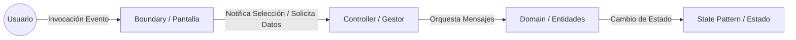
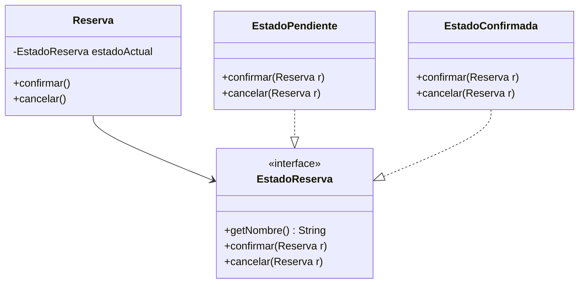

# Guía Práctica de Maven y Arquitectura Orientada a Objetos (PPAI / DSI)

Este documento es una guía clara y directa para comprender cómo funciona **Apache Maven**, cómo usar sus comandos esenciales y cómo estructurar un proyecto **Java 100% Orientado a Objetos (OO)** mapeando Diagramas de Secuencia, Entidades, Gestores de Casos de Uso, Pantallas (Boundaries) y Máquinas de Estado (Patrón State).

---

## 1. ¿Qué es Apache Maven y por qué se usa?

**Maven** es una herramienta de automatización y gestión de proyectos Java. En lugar de descargar archivos `.jar` manualmente y agregarlos al classpath de tu IDE, Maven se encarga de:

1. **Gestión de Dependencias:** Descarga automáticamente las librerías necesarias (como Hibernate, H2, JUnit) desde un repositorio central.
2. **Ciclo de Vida de Construcción:** Define fases estándar para limpiar, compilar, probar y empaquetar tu código.
3. **Estructura Estándar:** Convención de carpetas uniforme para que cualquier desarrollador entienda la organización inmediatamente.

### El Archivo `pom.xml` (Project Object Model)
Es el corazón del proyecto. Define los metadatos del proyecto y sus dependencias:

* **Coordenadas GAV:**
  * `<groupId>`: Identificador de la organización o equipo (ej. `com.ppai`).
  * `<artifactId>`: Nombre del proyecto (ej. `ppai-2026`).
  * `<version>`: Versión del proyecto (ej. `1.0.0-SNAPSHOT`).
* **`<dependencies>`:** Lista de librerías externas que tu proyecto necesita.
* **`<build>` / `<plugins>`:** Herramientas que extienden las capacidades de compilación o ejecución.

---

## 2. Comandos Basicos de Maven y Cuándo Usarlos

Los comandos se ejecutan desde la terminal en la raíz del proyecto (donde se encuentra el `pom.xml`).

### 🧹 `mvn clean`
* **¿Qué hace?:** Elimina la carpeta `/target` donde Maven guarda los archivos compilados `.class` y paquetes previos.
* **¿Por qué usarlo?:** Para asegurar una compilación desde cero ("limpia"). Si borraste una clase o cambiaste código y el IDE parece mantener código viejo desactualizado, `mvn clean` soluciona desincronizaciones.

### ⚙️ `mvn compile`
* **¿Qué hace?:** Compila el código fuente (`src/main/java`) y genera los archivos `.class` dentro de `target/classes`.
* **¿Por qué usarlo?:** Para verificar que no haya errores de sintaxis o tipo en tu código antes de ejecutarlo.

### 🧪 `mvn test`
* **¿Qué hace?:** Compila el código principal y las pruebas unitarias (`src/test/java`), y luego ejecuta el framework de testing (JUnit 5).
* **¿Por qué usarlo?:** Para validar las reglas de negocio y comprobar que ningún cambio reciente rompió funcionalidad existente.

### 📦 `mvn package`
* **¿Qué hace?:** Compila, ejecuta pruebas y empaqueta el proyecto en un archivo ejecutable/distribuible (por defecto un `.jar`) dentro de la carpeta `/target`.
* **¿Por qué usarlo?:** Cuando deseas generar el entregable final del sistema.

### 🚀 `mvn exec:java`
* **¿Qué hace?:** Ejecuta la clase `main` configurada en el plugin `exec-maven-plugin` de tu `pom.xml`.
* **¿Por qué usarlo?:** Para probar el sistema directamente desde la consola sin necesidad de abrir un IDE.

### 💡 Combinaciones Frecuentes en el Desarrollo Diario:
```bash
# Limpiar y compilar el proyecto
mvn clean compile

# Limpiar, compilar y ejecutar los test unitarios
mvn clean test

# Limpiar y ejecutar la aplicación principal directamente
mvn clean compile exec:java
```

---

## 3. Estructura Estándar de Directorios

Maven impone la siguiente estructura:

```text
ppai-2026/
├── pom.xml
└── src/
    ├── main/
    │   ├── java/
    │   │   └── com/
    │   │       └── ppai/
    │   │           ├── Main.java
    │   │           ├── boundary/       <-- Pantallas / Interfaz de Usuario
    │   │           ├── controller/     <-- Gestores de Casos de Uso
    │   │           ├── domain/
    │   │           │   ├── model/      <-- Entidades de Dominio
    │   │           │   └── state/      <-- Máquina de Estados (State Pattern)
    │   │           └── repository/     <-- Persistencia Hibernate / JPA
    │   └── resources/
    │       └── META-INF/
    │           └── persistence.xml     <-- Configuración H2 e Hibernate
    └── test/
        └── java/
            └── com/
                └── ppai/
                    └── MainTest.java
```

---

## 4. Mapeo de Diagramas (BCE / ECB) a Código Orientado a Objetos

En la metodología de diseño PPAI (Diseño de Sistemas de Información), el diseño se basa en la arquitectura **Boundary-Control-Entity (BCE / ECB)**.



### A. Capa Boundary (Pantallas / Interfaz)
* **Responsabilidad:** Representa la frontera del sistema con los actores del Diagrama de Secuencia.
* **Características OO:**
  * Recibe las entradas del usuario (teclado, clics).
  * Solicita confirmaciones.
  * **No contiene lógica de negocio:** Delega la ejecución del caso de uso llamando a métodos del `Gestor`.
* **Ejemplo en Código:**
  ```java
  public class PantallaRegistrarReserva {
      private final GestorRegistrarReserva gestor;

      public PantallaRegistrarReserva(GestorRegistrarReserva gestor) {
          this.gestor = gestor;
      }

      public void opcionRegistrarReserva() {
          gestor.opcionRegistrarReserva();
      }
  }
  ```

### B. Capa Controller (Gestor del Caso de Uso)
* **Responsabilidad:** Controla y orquesta la secuencia de pasos descrita en el Diagrama de Secuencia para un Caso de Uso específico.
* **Características OO:**
  * Guarda el **estado temporal del Caso de Uso** (ej: reserva seleccionada, cliente validado).
  * Envía mensajes a las clases del Dominio (Entidades).
  * Consulta y persiste objetos usando Hibernate/JPA.
* **Ejemplo en Código:**
  ```java
  public class GestorRegistrarReserva {
      private Reserva reservaEnCreacion;

      public void tomarSeleccionRecurso(Recurso recurso) {
          this.reservaEnCreacion = new Reserva();
          this.reservaEnCreacion.setRecurso(recurso);
          this.reservaEnCreacion.crearCambioEstadoInicial();
      }
  }
  ```

### C. Capa Domain (Entidades de Dominio)
* **Responsabilidad:** Representar los conceptos clave del negocio y encapsular los datos y comportamientos propios (Patrones GRASP: Experto en Información).
* **Regla de Oro OO:** Evitar "modelos anémicos" (clases que solo tienen getters y setters). Las reglas de validación y cálculo deben vivir dentro de la entidad correspondiente.

---

## 5. Máquina de Estados: Traslado del Diagrama de Estados con el Patrón State

Cuando una entidad cambia de comportamiento según su estado (ej: `Reserva` en estado *Pendiente*, *Confirmada*, *Cancelada*), se aplica el **Patrón State**.

### Diagrama del Patrón State:


### Ejemplo en Código:

1. **Interfaz de Estado:**
   ```java
   public interface EstadoReserva {
       String getNombre();
       void confirmar(Reserva reserva);
       void cancelar(Reserva reserva);
   }
   ```

2. **Estado Concreto Pendiente:**
   ```java
   public class EstadoPendiente implements EstadoReserva {
       @Override
       public String getNombre() { return "PENDIENTE"; }

       @Override
       public void confirmar(Reserva reserva) {
           // Transición de estado a Confirmada
           reserva.setEstadoActual(new EstadoConfirmada());
           System.out.println("La reserva ha pasado a estado CONFIRMADA.");
       }

       @Override
       public void cancelar(Reserva reserva) {
           reserva.setEstadoActual(new EstadoCancelada());
       }
   }
   ```

3. **La Entidad Delega en su Estado:**
   ```java
   public class Reserva {
       private EstadoReserva estadoActual;

       public void confirmar() {
           // Delega la regla de negocio al estado actual
           this.estadoActual.confirmar(this);
       }
   }
   ```

---

## 6. Opciones para la Capa de Presentación (Front / Boundary) 100% Orientada a Objetos

Si se requiere que la pantalla sea 100% orientada a objetos (evitando o minimizando programación funcional/procedural), existen 3 opciones principales en el ecosistema Java:

| Tecnología | Descripción | Ventajas OO | Recomendado Para |
| :--- | :--- | :--- | :--- |
| **Java Swing** (Desktop) | Biblioteca gráfica estándar integrada en el JDK. | 100% OO nativa (`JFrame`, `JPanel`, `JButton`). Cada componente visual es un objeto Java con métodos y eventos encapsulados. No requiere instalar librerías externas. | Cátedras académicas PPAI / Prototipos rápidos de escritorio. |
| **JavaFX** (Desktop Moderno) | Evolución moderna de Swing con soporte para CSS y binding de propiedades. | Componentes estructurados orientados a objetos con propiedades observables y controladores bien delimitados. | Aplicaciones de escritorio profesionales. |
| **Vaadin** (Web OO Pura) | Framework Web en el que la interfaz completa se escribe en **Java puro**. | Permite armar botones, grillas y formularios Web instanciando objetos Java (`Button`, `Grid`, `VerticalLayout`) en el backend **sin escribir HTML ni JS**. | Si se requiere interfaz WEB pero manteniendo el paradigma de Objetos en Java. |

---

## 7. Configuración de Hibernate + H2 ORM

El proyecto ya está configurado con **Hibernate 6.5** y **Base de Datos H2** en memoria.

### A. Annotations en las Entidades
* `@Entity`: Define que la clase se mapeará a una tabla de BD.
* `@Table(name = "...")`: Especifica el nombre de la tabla.
* `@Id` y `@GeneratedValue`: Define la clave primaria autogenerada.
* `@Column`: Mapea atributos a columnas.
* `@Transient`: Indica que un atributo es temporal en memoria y no debe guardarse en la BD (ej. clases de estado del patrón State si no usas converters).

### B. Uso de `EntityManager` mediante `JpaUtil`
Para persistir u obtener objetos en la BD:

```java
EntityManager em = JpaUtil.getEntityManager();
try {
    em.getTransaction().begin();
    
    Reserva nuevaReserva = new Reserva();
    em.persist(nuevaReserva); // Persistir en H2
    
    em.getTransaction().commit();
} catch (Exception e) {
    if (em.getTransaction().isActive()) em.getTransaction().rollback();
    throw e;
} finally {
    em.close();
}
```

---

## 8. Resumen de Pasos para Armar tus Casos de Uso

1. **Crear Entidades de Dominio:** Dentro de `domain/model/`. Mapea atributos, constructores y métodos de negocio.
2. **Crear Máquinas de Estado:** Dentro de `domain/state/`. Define la interfaz del estado y las clases concretas con las transiciones.
3. **Crear el Gestor del CU:** Dentro de `controller/`. Define la secuencia de métodos que responden a las acciones de los actores.
4. **Crear la Pantalla (Boundary):** Dentro de `boundary/`. Crea los componentes visuales o de consola que capturan entradas y llaman al Gestor.
5. **Ejecutar Pruebas y Compilar:** Ejecuta `mvn clean test` o `mvn exec:java` para verificar el comportamiento del sistema.
