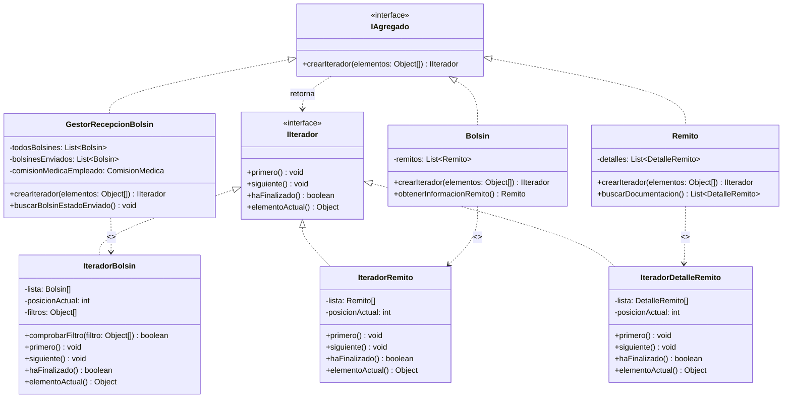

# Documento de Diseño de Software (SDD) y Guía Integral de Trazabilidad — CU 28: Registrar Recepción de Bolsín (con Patrón Iterator Propio)

> **Propósito de este documento:** Servir como guía completa y autoexplicativa para entender **qué resuelve** el sistema implementado, **cómo está organizada** la arquitectura, **cómo se implementa desde cero el Patrón Iterator (GoF)** sin usar interfaces del JDK, **cómo corre paso a paso la secuencia completa** (del flujo original al código real) y **qué tocar paso a paso en la interfaz gráfica JavaFX** para probar tanto el flujo básico como todos los caminos alternativos (`A1` a `A6` y `Obs. 1`).

---

## 1. Propósito, Contexto del Dominio y Problema que Resuelve

### 1.1 Contexto del Dominio (Bolsines · Organismo Controlador)
El sistema gestiona el traslado físico de documentación (expedientes, dictámenes médicos, estudios clínicos, cartas documento) entre más de 80 **Comisiones Médicas Jurisdiccionales (CMJ)** y la **Comisión Médica Central (CMC)** en CABA.

Para transportar esa documentación por correo físico, los envíos se agrupan dentro de **bolsines** cerrados con un **precinto numerado**:
- Cada **Bolsín** tiene una **Comisión Médica de Origen** y una **única Comisión Médica de Destino**, un historial de estados (`CambioEstadoBolsin`), y uno o más **Remitos**.
- Cada **Remito** agrupa uno o más **Detalles de Remito** (`DetalleRemito`), y cada detalle apunta a una **Documentación** concreta (que a su vez posee un **Tipo de Documento** e historial propio en `CambioEstadoDocumentacion`).

### 1.2 Qué Resuelve el CU 28 (e Inclusión del CU 29)
El **Caso de Uso 28 — Registrar Recepción de Bolsín** permite que el **Encargado de Bolsines (EdB)** de la Comisión Médica receptora:
1. Visualice únicamente los bolsines que fueron **enviados hacia su propia Comisión Médica**.
2. Seleccione un bolsín recibido e inspeccione su remito y las documentaciones declaradas.
3. Registre si la recepción fue conforme (Opción 1) o si existió alguna novedad: faltante de documentos (**A3**), documentos que no corresponden al destino (**A4**), o redirección interna a otra área cuando el destino es la **CMC** (**A5**).
4. Actualice de manera trazable los estados y transiciones de **Bolsín**, **Remito** y **Documentación**, registrando fecha/hora y el **Empleado responsable** en cada `CambioEstado*`.
5. Dispare automáticamente la inclusión del **CU 29 — Notificar Recepción de Bolsín** enviando un correo electrónico a la CM de origen con el detalle de lo recibido.

### 1.3 Qué Problema de Diseño Resuelve el Patrón Iterator Propio
En el CU 28 existen **tres recorridos sobre colecciones heterogéneas** con distintas necesidades:
1. Recorrer los **Bolsines** del sistema **filtrando** únicamente aquellos en estado `ENVIADO` cuya CM destino coincida con la del usuario logueado (`IteradorBolsin`).
2. Recorrer los **Remitos** asociados al bolsín seleccionado (`IteradorRemito`).
3. Recorrer los **Detalles de Remito** (`DetalleRemito`) de cada remito para consultar el asunto y tipo de cada documentación (`IteradorDetalleRemito`).

#### Decisión de Diseño y Restricción Estricta
Aplicando el **Patrón de Diseño Iterator (GoF)** construido **100% desde cero** (prohibido importar, extender o implementar `java.util.Iterator` o `java.lang.Iterable`):
- Los agregados (`GestorRecepcionBolsin`, `Bolsin`, `Remito`) implementan nuestra interfaz propia `IAgregado` y **no exponen ni gestionan los punteros ni las condiciones de corte/filtrado del recorrido**.
- Esa responsabilidad se delega en clases de fabricación pura (`IteradorBolsin`, `IteradorRemito`, `IteradorDetalleRemito`) que implementan nuestra interfaz propia `IIterador`.
- Además, se respeta la **corrección docente** de diseño: los métodos de visualización hacia la pantalla (`mostrarNumeroPrecinto()`, `mostrarCMOrigen()`, `solicitarSeleccionBolsin()`) se invocan **fuera del bucle** de iteración de bolsines, y `Remito.aceptar(...)` actúa como **orquestador único** de la aceptación de sus detalles y documentaciones.

---

## 2. Arquitectura y Mapa de Archivos del Proyecto

El proyecto sigue el patrón arquitectónico **Boundary – Control – Entity (BCE)** combinado con el paquete de iteradores propios (`com.ppai.iterator`) y un repositorio de datos mock (`com.ppai.repository.cu28`), sobre **Java 21**, **JavaFX 21** y **Maven**.

| Capa / Paquete | Archivo | Rol y Responsabilidad |
| :--- | :--- | :--- |
| **Arranque** | `src/main/java/com/ppai/Main.java` | Punto de entrada `main()`; delega en `JavaFxApp.main(args)`. |
| **Arranque JavaFX** | `src/main/java/com/ppai/JavaFxApp.java` | Crea la sesión inicial (`ComisionMedica`, `Empleado`, `Usuario`, `Sesion`), instancia `GestorRecepcionBolsin` y `PantallaRecepcionBolsin`, arma la ventana (`Scene`) e inicia el CU invocando `pantalla.tomarOpcionRegistrarRecepcionBolsin()`. |
| **Boundary (UI)** | `src/main/java/com/ppai/boundary/cu28/PantallaRecepcionBolsin.java` | Interfaz gráfica JavaFX (Stepper de 4 pasos) con los métodos exactos del diagrama de secuencia (`habilitar`, `mostrarCM`, `mostrarBolsines`, `mostrarDatosDeRemito`, etc.). |
| **Boundary (Modelo UI)** | `src/main/java/com/ppai/boundary/cu28/DocumentacionRow.java` | Adaptador visual reactivo de cada fila de `Documentacion` (contiene el checkbox `¿Conforme?` para A3/A4 y calcula la vista previa de estado resultante). |
| **Boundary (Externo)** | `src/main/java/com/ppai/boundary/cu28/InterfazServidorCorreo.java` | Simula la interfaz externa del **CU 29** transmitiendo la `NotificacionRecepcionBolsin`. |
| **Control** | `src/main/java/com/ppai/controller/cu28/GestorRecepcionBolsin.java` | Controlador del CU 28 y **1.er Agregado Concreto** (`implements IAgregado`). Orquesta mensajes entre Pantalla, Iteradores y Entidades. |
| **Patrón Iterator** | `src/main/java/com/ppai/iterator/IAgregado.java` | Interfaz propia del Agregado: `crearIterador(Object[] elementos)`. |
| **Patrón Iterator** | `src/main/java/com/ppai/iterator/IIterador.java` | Interfaz propia del Iterador: `primero()`, `siguiente()`, `haFinalizado()`, `elementoActual()`. |
| **Patrón Iterator** | `src/main/java/com/ppai/iterator/IteradorBolsin.java` | **1.er Iterador Concreto**: recorre `Bolsin[]` filtrando por estado `ENVIADO` y CM destino mediante `comprobarFiltro(Object[])`. |
| **Patrón Iterator** | `src/main/java/com/ppai/iterator/IteradorRemito.java` | **2.do Iterador Concreto**: recorre `Remito[]` del bolsín seleccionado. |
| **Patrón Iterator** | `src/main/java/com/ppai/iterator/IteradorDetalleRemito.java` | **3.er Iterador Concreto**: recorre `DetalleRemito[]` de cada remito. |
| **Entity (Dominio)** | `src/main/java/com/ppai/domain/model/cu28/Bolsin.java` | Entidad central y **2.do Agregado Concreto** (`implements IAgregado`). Fabrica `IteradorRemito` y gestiona su historial de estados. |
| **Entity (Dominio)** | `src/main/java/com/ppai/domain/model/cu28/Remito.java` | **3.er Agregado Concreto** (`implements IAgregado`). Fabrica `IteradorDetalleRemito` y orquesta `aceptar(...)`. |
| **Entity (Dominio)** | `src/main/java/com/ppai/domain/model/cu28/DetalleRemito.java` | Enlace entre `Remito` y `Documentacion`; expone `obtenerAsuntoYTipoDoc()` y delega `aceptar(...)`. |
| **Entity (Dominio)** | `src/main/java/com/ppai/domain/model/cu28/Documentacion.java` | Implementa transiciones de estado (`aceptar`, `marcarNoRecibida`, `rechazar`, `paraRedirigir`) creando `CambioEstadoDocumentacion`. |
| **Entity (Dominio)** | `src/main/java/com/ppai/domain/model/cu28/TipoDocumento.java` | Nombre descriptivo del tipo de documento (`getNombre()`). |
| **Entity (Dominio)** | `src/main/java/com/ppai/domain/model/cu28/CambioEstadoBolsin.java` | Registro histórico (`estado`, `fechaHoraInicio`, `fechaHoraFin`, `empleado`) del bolsín. |
| **Entity (Dominio)** | `src/main/java/com/ppai/domain/model/cu28/CambioEstadoDocumentacion.java` | Registro histórico (`estado`, `fechaHoraInicio`, `fechaHoraFin`, `empleado`) de la documentación. |
| **Entity (Dominio)** | `src/main/java/com/ppai/domain/model/cu28/Estado.java` | Estado polivalente (`ambito` + `nombre`) para Bolsín, Remito y Documentación. |
| **Entity (Dominio)** | `src/main/java/com/ppai/domain/model/cu28/ComisionMedica.java` | Sede emisora o receptora (`esTuCMDestino(...)`, `getNombre()`). |
| **Entity (Dominio)** | `src/main/java/com/ppai/domain/model/cu28/Sesion.java` / `Usuario.java` / `Empleado.java` | Cadena de identificación del usuario autenticado y su Comisión Médica asignada. |
| **Entity (Dominio)** | `src/main/java/com/ppai/domain/model/cu28/OpcionRecepcion.java` | Modela las 4 opciones de recepción de la regla de negocio. |
| **Entity (Dominio)** | `src/main/java/com/ppai/domain/model/cu28/NotificacionRecepcionBolsin.java` | Cuerpo y metadatos del correo generado para el CU 29. |
| **Repositorio Mock** | `src/main/java/com/ppai/repository/cu28/RepositorioMockBolsines.java` | Construye los datos de prueba (`PREC-7041`, `PREC-8820`, `PREC-9150`, `PREC-9999`) para los escenarios 1 (CMC) y 2 (Rosario). |
| **Pruebas** | `src/test/java/com/ppai/IteratorPatternTest.java` | 14 pruebas unitarias, estructurales y de reflexión del patrón Iterator propio. |
| **Pruebas** | `src/test/java/com/ppai/CU28Test.java` | 16 pruebas de integración cubriendo flujo básico, A1–A6 y Obs. 1. |

---

## 3. Diseño Estático del Patrón Iterator Propio

### 3.1 Contratos Base (`IAgregado` e `IIterador`)

1. **`IAgregado`** (`src/main/java/com/ppai/iterator/IAgregado.java`)
   - Define la operación de fabricación pura:
     ```java
     IIterador crearIterador(Object[] elementos);
     ```
   - **No extiende `java.lang.Iterable`**.

2. **`IIterador`** (`src/main/java/com/ppai/iterator/IIterador.java`)
   - Define las operaciones uniformes de recorrido secuencial:
     ```java
     void primero();
     void siguiente();
     boolean haFinalizado();
     Object elementoActual();
     ```
   - **No extiende `java.util.Iterator`**.

### 3.2 Los 3 Iteradores Concretos y Cómo Funcionan por Dentro

#### A. `IteradorBolsin` (`src/main/java/com/ppai/iterator/IteradorBolsin.java`)
- **Atributos:**
  - `private Bolsin[] lista` — arreglo de todos los bolsines recibidos desde el Gestor.
  - `private int posicionActual` — cursor entero actual sobre `lista` (`0` si `lista` está vacía, `-1` antes de llamar a `primero()` si no está vacía).
  - `private Object[] filtros` — criterios de filtrado (en índice `0` contiene la `ComisionMedica` o `String` del usuario logueado).
- **Cómo se ejecuta internamente:**
  - `primero()`: pone `posicionActual = 0` y avanza en un `while` mientras `!comprobarFiltro(this.filtros)` para estacionarse en el **primer bolsín válido**.
  - `comprobarFiltro(Object[] filtro)`:
    1. Verifica que `posicionActual` esté en rango y que `bolsin != null`.
    2. Llama a `bolsin.sosEnviado()` (estado actual del bolsín debe ser `ENVIADO`).
    3. Si existe criterio en `filtro[0]`, verifica `bolsin.esTuCMDestino((ComisionMedica) cmFiltro)` o `bolsin.esTuCMDestino((String) cmFiltro)`.
  - `haFinalizado()`: retorna `true` si `lista.length == 0` o `posicionActual >= lista.length`.
  - `elementoActual()`: si no ha finalizado y `posicionActual >= 0`, evalúa `comprobarFiltro(this.filtros)` (siguiendo el diagrama de secuencia de `message.md`) y retorna `lista[posicionActual]` solo si cumple el filtro (o `null` en caso contrario).
  - `siguiente()`: incrementa `posicionActual` y vuelve a saltar cualquier bolsín que no cumpla `comprobarFiltro(this.filtros)`.

#### B. `IteradorRemito` (`src/main/java/com/ppai/iterator/IteradorRemito.java`)
- **Atributos:**
  - `private Remito[] lista` — arreglo de remitos del bolsín seleccionado.
  - `private int posicionActual` — índice actual (inicia en `0`).
- **Cómo se ejecuta internamente:**
  - `primero()` reinicia `posicionActual = 0`.
  - `haFinalizado()` devuelve `posicionActual >= lista.length`.
  - `elementoActual()` devuelve `lista[posicionActual]` (o `null` si finalizó).
  - `siguiente()` avanza `posicionActual++` mientras `!haFinalizado()`.

#### C. `IteradorDetalleRemito` (`src/main/java/com/ppai/iterator/IteradorDetalleRemito.java`)
- **Atributos:**
  - `private DetalleRemito[] lista` — arreglo de detalles pertenecientes a un remito.
  - `private int posicionActual` — índice actual (inicia en `0`).
- **Cómo se ejecuta internamente:** Idéntico contrato secuencial sobre `DetalleRemito[]`.

### 3.3 Los 3 Agregados Concretos

| Agregado Concreto | Archivo | Método `crearIterador(...)` | Qué Iterador Fabrica |
| :--- | :--- | :--- | :--- |
| `GestorRecepcionBolsin` | `GestorRecepcionBolsin.java` (líneas 119–138) | `crearIterador(Object[])` y `crearIterador(Bolsin[])` | `new IteradorBolsin(array, new Object[]{ this.comisionMedicaEmpleado })` |
| `Bolsin` | `Bolsin.java` (líneas 110–127) | `crearIterador(Object[])` y `crearIterador(Remito[])` | `new IteradorRemito(array)` |
| `Remito` | `Remito.java` (líneas 35–52) | `crearIterador(Object[])` y `crearIterador(DetalleRemito[])` | `new IteradorDetalleRemito(array)` |

### 3.4 Diagrama de Clases del Patrón Iterator Implementado



---

## 4. Trazabilidad Paso a Paso: De la Secuencia al Código (Flujo Básico)

A continuación se detalla **exactamente cómo corre el programa de principio a fin** en el flujo básico, siguiendo los **9 bloques** de la secuencia original (`CU28_Registrar_Recepcion_Bolsin.md`) y su versión rediseñada con Iterator (`message.md`).

> **Cómo leer esta sección:** Cada bloque muestra:
> 1. **Qué ocurre en el flujo**.
> 2. **La cadena exacta de llamadas** (`Emisor -> Receptor : método()`), indicando el **archivo** y **línea/método**.
> 3. **Qué atributos cambian o se leen** en los objetos en memoria.

---

### Bloque 1 — Inicio del Caso de Uso e Identificación de la Comisión Médica (Pasos 1–8)

1. Al abrir la aplicación (`JavaFxApp.java`, línea 49), la pantalla invoca `pantalla.tomarOpcionRegistrarRecepcionBolsin()`.
2. La pantalla se habilita y limpia selecciones previas, mostrando el **Paso 1** del Stepper.
3. El `GestorRecepcionBolsin` navega la cadena `Sesion → Usuario → Empleado → ComisionMedica` para averiguar **en qué Comisión Médica trabaja el usuario logueado** y la muestra en el encabezado de la pantalla.

**Trazabilidad en el código:**

```text
JavaFxApp.start() [JavaFxApp.java:49]
 └─► PantallaRecepcionBolsin.tomarOpcionRegistrarRecepcionBolsin() [PantallaRecepcionBolsin.java:115]
      ├─► this.habilitar() [:123]
      │     ├─ this.habilitada = true
      │     ├─ this.bolsinSeleccionadoEnTabla = null
      │     ├─ this.opcionSeleccionadaActual = null
      │     └─ irAPaso(1)
      └─► gestor.tomarOpcionRegistrarRecepcionBolsin() [GestorRecepcionBolsin.java:78]
            ├─ Limpia atributos de ejecución anterior (bolsinSeleccionado, remitoSeleccionado, opcionSeleccionada, documentacionesNoConformes)
            ├─► this.buscarUsuario() [:109]
            │     ├─► sesionActual.getUsuario() [Sesion.java:16] ──► usuarioActual
            │     ├─► this.empleadoActual = usuarioActual.getEmpleado() [Usuario.java:26]
            │     └─► this.comisionMedicaEmpleado = usuarioActual.getCMEmpleado() [Usuario.java:18]
            │           └─► empleado.getCM() [Empleado.java:20] ──► retorna ComisionMedica
            └─► pantalla.mostrarCM(comisionMedicaEmpleado) [PantallaRecepcionBolsin.java:134]
                  └─ Actualiza lblCmActiva ("CM Destino: Comisión Médica Central (CMC) - CABA")
```

- **Atributos modificados en `GestorRecepcionBolsin`:** `empleadoActual`, `comisionMedicaEmpleado`, y reseteo a `null`/vacío de `bolsinSeleccionado`, `remitoSeleccionado`, `opcionSeleccionada`, `documentacionesNoConformes`.

---

### Bloque 2 — Búsqueda de Bolsines en Estado `ENVIADO` con `IteradorBolsin` (Pasos 9–12 + Loop 2)

En la secuencia original (`CU28_Registrar_Recepcion_Bolsin.md`), el `Gestor` hacía un bucle directo sobre todos los bolsines preguntando `bolsin.sosEnviado()`. Con la decisión de diseño del **Patrón Iterator**:
- El `Gestor` convierte su lista `todosBolsines` en arreglo y fabrica un `IteradorBolsin` pasándole la `comisionMedicaEmpleado` dentro de `filtros`.
- **Toda la lógica de filtrado queda encapsulada dentro de `IteradorBolsin.comprobarFiltro(...)`**.

**Trazabilidad en el código:**

```text
GestorRecepcionBolsin.tomarOpcionRegistrarRecepcionBolsin() [:95]
 └─► this.buscarBolsinEstadoEnviado() [GestorRecepcionBolsin.java:144]
      ├─ this.bolsinesEnviados.clear()
      ├─ elementos = todosBolsines.toArray(new Bolsin[0])
      ├─► itBol = this.crearIterador(elementos) [GestorRecepcionBolsin.java:119]
      │     └─► new IteradorBolsin(array, new Object[]{ this.comisionMedicaEmpleado }) [IteradorBolsin.java:19]
      ├─► itBol.primero() [IteradorBolsin.java:88]
      │     └─ Posiciona posicionActual = 0 y salta elementos mientras !comprobarFiltro(this.filtros)
      └─► while (!itBol.haFinalizado()) [GestorRecepcionBolsin.java:149]
            ├─► itBol.haFinalizado() [IteradorBolsin.java:106]
            ├─► bolsin = (Bolsin) itBol.elementoActual() [IteradorBolsin.java]
            │     └─► comprobarFiltro(this.filtros) [IteradorBolsin.java:56]
            │           ├─► bolsin.sosEnviado() [Bolsin.java:42]
            │           │     ├─► actual = obtenerCambioActual() [:204] ──► CambioEstadoBolsin.sosActual() [:29]
            │           │     └─► actual.sosEnviado() [CambioEstadoBolsin.java:34] ──► Estado.esEnviado() [:32]
            │           └─► bolsin.esTuCMDestino(cmFiltro) [Bolsin.java:64 / :69]
            │                 └─► cmDestino.esTuCMDestino(...) [ComisionMedica.java:17 / :23]
            ├─► bolsin.getNombreCMOrigen() [Bolsin.java:105] ──► cmOrigen.getNombre() (método nuevo de diseño)
            ├─► bolsin.getNroPrecinto() [Bolsin.java:82] (retorna precinto como int)
            ├─ bolsinesEnviados.add(bolsin)
            └─► itBol.siguiente() [IteradorBolsin.java:96] (avanza al siguiente bolsín que cumpla comprobarFiltro)
```

- **Qué pasa con `PREC-9999` (destino Salta):** Cuando `IteradorBolsin` evalúa `comprobarFiltro(...)` sobre `PREC-9999`, `bolsin.esTuCMDestino(...)` retorna `false`, por lo que `primero()` / `siguiente()` lo salta automáticamente y **nunca llega a `bolsinesEnviados`**.

---

### Bloque 3 — Mostrar Bolsines Enviados en Pantalla (Corrección Docente: Fuera del Loop) (Pasos 13–15)

En la secuencia original existía un loop que llamaba a `mostrarNumeroPrecinto()` y `mostrarCMOrigen()` en cada iteración. La **corrección del profesor** indicó sacar las llamadas a pantalla fuera del bucle para mostrar toda la colección de una sola vez:

**Trazabilidad en el código (`GestorRecepcionBolsin.java`, líneas 98–103):**

```text
GestorRecepcionBolsin.tomarOpcionRegistrarRecepcionBolsin() [fuera del bucle]
 ├─► pantalla.mostrarBolsines(bolsinesEnviados) [PantallaRecepcionBolsin.java:144]
 │     ├─ Carga listaBolsinesData en tblBolsines (columnas Nº Precinto, CM Origen, Nº Remito, Fecha, Estado)
 │     └─ Carga las CM Origen disponibles en cmbFiltroCMOrigen
 ├─► pantalla.mostrarNumeroPrecinto() [PantallaRecepcionBolsin.java:165]
 ├─► pantalla.mostrarCMOrigen() [PantallaRecepcionBolsin.java:173]
 └─► pantalla.solicitarSeleccionBolsin() [PantallaRecepcionBolsin.java:184]
       └─ Habilita/deshabilita btnSeleccionarBolsin según selección de la tabla
```

---

### Bloque 4 — Selección del Bolsín y Recorrido Anidado con `IteradorRemito` e `IteradorDetalleRemito` (Pasos 16–22)

Cuando el Encargado de Bolsines hace clic en un bolsín de la tabla y pulsa **"Seleccionar Bolsín e Inspeccionar Contenido →"** (o doble clic), el Gestor guarda `bolsinSeleccionado` y delega la obtención de remitos y documentación al propio `Bolsin`, que a su vez usa `IteradorRemito`, y cada `Remito` usa `IteradorDetalleRemito`.

**Trazabilidad en el código:**

```text
PantallaRecepcionBolsin.tomarSeleccionBolsin(bolsin) [PantallaRecepcionBolsin.java:191]
 └─► gestor.tomarSeleccionBolsin(bolsin) [GestorRecepcionBolsin.java:196]
       ├─ this.bolsinSeleccionado = bolsin
       └─► this.obtenerInformacionRemito() [GestorRecepcionBolsin.java:228]
             └─► this.remitoSeleccionado = bolsinSeleccionado.obtenerInformacionRemito() [Bolsin.java:132]
                   ├─► iterador = this.crearIterador(remitos) [Bolsin.java:110]
                   │     └─► new IteradorRemito(array) [IteradorRemito.java:16]
                   ├─► iterador.primero() [IteradorRemito.java:36]
                   └─► while (!iterador.haFinalizado()) [Bolsin.java:137]
                         ├─► r = (Remito) iterador.elementoActual() [IteradorRemito.java]
                         ├─► r.getNumero() [Remito.java:30]
                         ├─► r.buscarDocumentacion() [Remito.java:55]
                         │     ├─► itDet = this.crearIterador(detalles) [Remito.java:35]
                         │     │     └─► new IteradorDetalleRemito(array) [IteradorDetalleRemito.java:17]
                         │     ├─► itDet.primero() [IteradorDetalleRemito.java:37]
                         │     └─► while (!itDet.haFinalizado()) [Remito.java:60]
                         │           ├─► det = (DetalleRemito) itDet.elementoActual() [IteradorDetalleRemito.java]
                         │           ├─► det.obtenerAsuntoYTipoDoc() [DetalleRemito.java:27] *(reemplaza a getDocumentacion() en el diseño)*
                         │           │     ├─► documentacion.getAsunto() [Documentacion.java:29]
                         │           │     └─► documentacion.mostrarTipoDocumentacion() [Documentacion.java:34]
                         │           │           └─► tipoDocumento.getNombre() [TipoDocumento.java:18]
                         │           └─► itDet.siguiente() [IteradorDetalleRemito.java:42]
                         └─► iterador.siguiente() [IteradorRemito.java:41]
```

> **Nota de trazabilidad (método nuevo de diseño):** Según `contexto-ppai-cu28.md` y `message.md`, `DetalleRemito.obtenerAsuntoYTipoDoc()` evita que `Remito` pida la referencia directa `getDocumentacion()` solo para extraer el asunto y el tipo de documento.

---

### Bloque 5 — Visualización de Remito, Opciones de Recepción y Confirmación (Pasos 23–30)

1. Inmediatamente después de `bolsinSeleccionado.obtenerInformacionRemito()`, `GestorRecepcionBolsin.obtenerInformacionRemito()` (líneas 240–247) envía a la pantalla:
   - `pantalla.mostrarDatosDeRemito(remitoSeleccionado)` → rellena etiquetas del Paso 2, invoca `remito.buscarDocumentacion()` para poblar `tblDocumentacion` con objetos `DocumentacionRow`, y cambia la vista a `irAPaso(2)`.
   - `buscarOpcionesRecepcion()` → genera las 4 instancias de `OpcionRecepcion`.
   - `pantalla.mostrarOpcionesRecepcion(opciones)` → dibuja las 4 tarjetas con RadioButtons (deshabilitando la Opción 4 si la CM activa no es CMC).
   - `pantalla.solicitarSeleccionOpcion()`.
2. Cuando el usuario elige la opción y pulsa **"Continuar a Confirmación →"**:
   - `PantallaRecepcionBolsin.tomarSeleccionOpcion(opcion)` (línea 264) recolecta los documentos desmarcados (si `opcion.isRequiereSeleccionDocs()`) en `docsNoConformes`.
   - Llama a `gestor.tomarSeleccionOpcion(opcion, docsNoConformes)` (línea 307).
   - El Gestor guarda `this.opcionSeleccionada = opcion` y una copia defensiva `this.documentacionesNoConformes = new ArrayList<>(docsNoConformes)`.
   - Llama a `pantalla.solicitarConfirmacionSeleccion(...)` (línea 283) y avanza al **Paso 3** (`irAPaso(3)`).
3. Cuando el usuario pulsa **"✔ Confirmar Recepción de Bolsín"**:
   - `PantallaRecepcionBolsin.tomarConfirmacionSeleccion(true)` (línea 334) → `gestor.tomarConfirmacionSeleccion(true)` (línea 338).

---

### Bloque 6 — Obtención de los Estados del Sistema (Paso 31 + Loops 6)

Al recibir `confirmada == true`, el Gestor invoca `obtenerEstado()` (`GestorRecepcionBolsin.java`, líneas 383–407), recorriendo `estadosDisponibles`:
- **Ámbito Bolsín:** `estado.esAmbitoBolsin() && estado.esEstadoRecibidoEnCMDestino()` → guarda `estadoRecibidoCMDestino`.
- **Ámbito Remito:** `estado.esAmbitoRemito() && estado.esRecibidoYAceptado()` / `esRecibidoYAceptadoParcial()` → guarda `estadoRemitoRecibidoAceptado` y `estadoRemitoRecibidoAceptadoParcial`.
- **Ámbito Documentación:** `estado.esAmbitoDocumentacion()` combinado con `esRecibidoYAceptado()`, `esNoRecibida()`, `esRecibidaYRechazada()` y `esParaRedirigir()` → guarda los 4 estados destino posibles.

---

### Bloque 7 — Actualización del Estado del Bolsín (Pasos 32–38)

El Gestor obtiene la hora del sistema y transiciona el Bolsín seleccionado:

```text
GestorRecepcionBolsin.tomarConfirmacionSeleccion(true) [:355-358]
 ├─► this.getFechaHoraActual() [:412] ──► this.fechaHoraActual = LocalDateTime.now()
 └─► this.actualizarEstadoBolsin() [:419]
       └─► bolsinSeleccionado.marcarRecibido(estadoRecibidoCMDestino, fechaHoraActual, empleadoActual) [Bolsin.java:175]
             ├─► actual = obtenerCambioActual() [:204] (busca CambioEstadoBolsin.sosActual() == true)
             ├─► actual.setFechaHoraFin(fechaHoraActual) [CambioEstadoBolsin.java:39]
             └─► crearNuevoCambioDeEstado(estadoRecibidoCMDestino, fechaHoraActual, empleadoActual) [Bolsin.java:199]
                   └─► new CambioEstadoBolsin(estado, fechaHoraInicio, empleado) [CambioEstadoBolsin.java:21]
                         └─ Se agrega a cambiosDeEstado con fechaHoraFin = null (nuevo estado vigente)
```

---

### Bloque 8 — Actualización de Remitos, Detalles y Documentación (Pasos 39–40 + Loop 8)

Siguiendo la **corrección docente** en `message.md`, en el flujo básico (Opción 1) `Remito.aceptar(...)` actúa como orquestador único sobre sus `DetalleRemito`:

```text
GestorRecepcionBolsin.tomarConfirmacionSeleccion(true) [:361]
 └─► this.actualizarRemitoYDocumentacion() [GestorRecepcionBolsin.java:436]
       ├─ [Caso Opción 1 - Flujo Básico]
       │    ├─► remitoSeleccionado.marcarRecibidoYAceptado(estadoRemitoRecibidoAceptado) [Remito.java:84]
       │    └─► bolsinSeleccionado.actualizarRemitoYDocumentacion(estadoDocRecibidaAceptada, fechaHoraActual, empleadoActual) [Bolsin.java:186]
       │          └─► for (Remito r : remitos) -> r.aceptar(estadoDocRecibidaAceptada, fechaHoraActual, empleadoActual) [Remito.java:77]
       │                └─► for (DetalleRemito detalle : detalles) -> detalle.aceptar(...) [Remito.java:79 / DetalleRemito.java:43]
       │                      └─► documentacion.aceptar(estadoRecibidoYAceptado, fechaHoraActual, empleado) [Documentacion.java:43]
       │                            ├─► cerrarCambioActual(fechaHoraActual) [:66]
       │                            │     ├─ CambioEstadoDocumentacion.sosActual() [CambioEstadoDocumentacion.java:29]
       │                            │     └─ actual.setFechaHoraFin(fechaHoraActual) [CambioEstadoDocumentacion.java:34]
       │                            └─► newCambioEstadoDocumentacion(estado, fechaHoraActual, empleado) [Documentacion.java:78]
       │                                  └─► new CambioEstadoDocumentacion(...) [CambioEstadoDocumentacion.java:21]
       └─ [Casos A3 / A4 / A5] -> Aplican marcarRecibidoYAceptadoParcial / marcarRecibidoYAceptado
                                  y llaman doc.marcarNoRecibida / doc.rechazar / doc.aceptar / doc.paraRedirigir
```

---

### Bloque 9 — Notificación CU 29 y Fin del Caso de Uso (Pasos 41–44)

```text
GestorRecepcionBolsin.tomarConfirmacionSeleccion(true) [:364-372]
 ├─► this.notificarRecepcion() [GestorRecepcionBolsin.java:492]
 │     ├─ Construye el detalle de cada documentación recorriendo remitoSeleccionado.buscarDocumentacion()
 │     ├─ Arma emailOrigen ("despacho.<cmorigen>@srt.gob.ar")
 │     ├─ Instancia this.ultimaNotificacionEnviada = new NotificacionRecepcionBolsin(...) [:507]
 │     └─► servidorCorreo.enviarNotificacion(ultimaNotificacionEnviada) [InterfazServidorCorreo.java:15] (<<includes>> CU 29)
 ├─► pantalla.informarCorrectoEnvioNotificacion(ultimaNotificacionEnviada) [PantallaRecepcionBolsin.java:345]
 │     └─ Muestra banner de éxito, cuerpo del correo en txtCuerpoCorreoCU29 y avanza al Paso 4 (irAPaso(4))
 └─► this.finCU() [GestorRecepcionBolsin.java:527]
       └─ Limpia referencias transitorias (bolsinSeleccionado, remitoSeleccionado, opcionSeleccionada, documentacionesNoConformes)
```

---

## 5. Guía Práctica de Interfaz Gráfica (Qué tocar paso a paso) y Caminos Alternativos

### 5.1 Anatomía de la Pantalla (`PantallaRecepcionBolsin.java`)
La ventana JavaFX está organizada en:
- **Barra Superior (`headerBar`)**:
  - Chips de sesión sincronizados en vivo: `Usuario` (muestra username y nombre del empleado activo) y `CM Destino`.
  - Selector **`Mock:`** (arriba a la derecha): permite cambiar en vivo entre escenarios y vuelve automáticamente al Paso 1 mostrando los bolsines correspondientes al usuario logueado:
    - `Escenario 1: Comisión Médica Central (CMC)` (usuario `jperez.cmc` — **3 bolsines dirigidos a CMC** y **habilita Opción 4 / A5**).
    - `Escenario 2: CMJ Regional (Rosario)` (usuario `mlopez.rosario` — **2 bolsines dirigidos a Rosario** y **bloquea Opción 4 / A5**).
  - Botón rojo **`✕ Cancelar (Obs. 1)`**: cancela el CU desde cualquier paso.
- **Stepper (4 Pasos)**: `1. Bolsines Enviados` → `2. Remito y Documentación` → `3. Confirmación de Recepción` → `4. Resultado y Notificación CU 29`.

### 5.2 Bolsines Precargados (`RepositorioMockBolsines.java` — Pool de 7 Bolsines)

El repositorio carga los 7 bolsines del sistema y **`IteradorBolsin`** filtra en vivo según la CM del usuario activo y el estado `ENVIADO` (la tabla del Paso 1 muestra el contador exacto `"IteradorBolsin filtró X bolsín(es)... sobre 7 bolsines totales"` junto a la columna `CM de Destino`):

| Nº Precinto | Remito | CM Origen | CM Destino | Estado inicial | Documentación | Uso recomendado en pruebas |
| :--- | :--- | :--- | :--- | :--- | :--- | :--- |
| **`PREC-7041`** | `REM-2026-00458` | CMJ N° 1 - Córdoba Capital | `CMC - CABA` | `ENVIADO` | 2 documentos | **Escenario 1 (CMC) — Flujo Básico (Opción 1)** |
| **`PREC-8820`** | `REM-2026-00892` | CMJ N° 4 - Mendoza | `CMC - CABA` | `ENVIADO` | 4 documentos | **Escenario 1 (CMC) — Alternativos A3 y A4** |
| **`PREC-9150`** | `REM-2026-01204` | CMJ N° 11 - La Plata | `CMC - CABA` | `ENVIADO` | 1 documento | **Escenario 1 (CMC) — Alternativo A5** |
| **`PREC-6015`** | `REM-2026-02110` | CMJ N° 5 - Santa Fe Capital | `CMJ N° 7 - Rosario` | `ENVIADO` | 2 documentos | **Escenario 2 (Rosario) — Flujo en Regional (A5 bloqueada)** |
| **`PREC-6088`** | `REM-2026-02145` | `CMC - CABA` | `CMJ N° 7 - Rosario` | `ENVIADO` | 3 documentos | **Escenario 2 (Rosario) — Alternativos A3 y A4** |
| **`PREC-9999`** | `REM-2026-99999` | CMJ N° 7 - Rosario | `CMJ N° 99 - Salta` | `ENVIADO` | 1 documento | **Control negativo por destino**: excluido por `IteradorBolsin` |
| **`PREC-5500`** | `REM-2026-00112` | CMJ N° 1 - Córdoba Capital | `CMC - CABA` | `RECIBIDO_EN_CM_DESTINO` | 1 documento | **Control negativo por estado**: excluido por `IteradorBolsin` |

---

### 5.3 Paso a Paso en la UI: Flujo Básico (Opción 1)

1. **Paso 1 (`Bolsines Enviados`)**:
   - Verificá que arriba diga `Mock: Escenario 1: Comisión Médica Central (CMC)` (viene seleccionado por defecto) y que la tabla muestre 3 filas (`PREC-7041`, `PREC-8820`, `PREC-9150`).
   - Hacé clic sobre la fila **`PREC-7041`** y luego clic en el botón azul **`Seleccionar Bolsín e Inspeccionar Contenido →`** (o doble clic sobre la fila).
2. **Paso 2 (`Remito y Documentación`)**:
   - Arriba ves el resumen: `PREC-7041`, `REM-2026-00458`, `2` documentos.
   - En la tabla de documentación dejá ambos casilleros **`¿Conforme?`** tildados (vienen marcados por defecto).
   - En las tarjetas inferiores dejá marcada la **`Opción 1 — El contenido es igual al registrado`** (viene preseleccionada).
   - Hacé clic en **`Continuar a Confirmación →`**.
3. **Paso 3 (`Confirmación de Recepción`)**:
   - Revisá los badges: Bolsín → `Recibido en CM Destino`, Remito → `Recibido y aceptado`, cada documento → `Recibida y aceptada`.
   - Hacé clic en el botón verde **`✔ Confirmar Recepción de Bolsín`**.
4. **Paso 4 (`Resultado y Notificación CU 29`)**:
   - Ves el cartel verde `¡Recepción Registrada con Éxito!` y el comprobante del correo electrónico dirigido a `despacho.cmjn1crdobacapital@srt.gob.ar`.
   - Si querés iniciar otra prueba, tocá **`↻ Registrar Nueva Recepción de Bolsín`** (observá que el bolsín ya recepcionado pasó de `ENVIADO` a `RECIBIDO_EN_CM_DESTINO`, por lo que `IteradorBolsin` ya no lo volverá a listar).

---

### 5.4 Caminos Alternativos (`A1` a `A6` y `Obs. 1`) — Qué tocar y qué ocurre en el código

#### Flujo Alternativo A1 — No se encuentra bolsín con el Nº de precinto ingresado
- **Qué tocar en la UI (Paso 1):**
  1. En el panel `Filtros de Búsqueda`, hacé clic en el campo de texto **`Buscar por Nº de precinto (ej. PREC-7041)...`**.
  2. Escribí un precinto inexistente, por ejemplo `PREC-0000`.
- **Qué ocurre en pantalla:**
  - La tabla se vacía (`No se encontraron bolsines enviados para esta Comisión Médica.`).
  - Aparece un cartel amarillo de advertencia arriba de la tabla: `⚠ Flujo Alternativo A1: No se encuentra bolsín con el número de precinto ingresado: 'PREC-0000'.`
  - Si borrás el texto hasta volver a tener coincidencias o tocás **`Limpiar`**, la alerta desaparece automáticamente.
- **Qué ocurre en el código:**
  - El listener de `txtFiltroPrecinto` invoca `PantallaRecepcionBolsin.aplicarFiltros()` (línea 743) → `ocultarAlertaPaso1()` → `gestor.filtrarBolsines(precinto, origen)` (línea 164) → al quedar vacía la lista filtrada por precinto, llama a `pantalla.mostrarAlerta("Flujo Alternativo A1", ...)` y retorna sin pisarla con A2.

#### Flujo Alternativo A2 — No se encuentra bolsín con la CM origen ingresada
- **Qué tocar en la UI (Paso 1):**
  1. En el desplegable **`Todas las CM Origen`** (que incluye el catálogo de Comisiones Médicas del sistema), elegí una CM sin envíos para el destino activo (por ejemplo `CMJ N° 99 - Salta` o `CMJ N° 5 - Santa Fe Capital` estando en CMC).
- **Qué ocurre en pantalla y en el código:**
  - `gestor.filtrarBolsines(precinto, filtroCMOrigen)` (líneas 180–189) filtra por `b.getCMOrigen().getId().equals(filtroCMOrigen.getId())`; al quedar vacía, invoca `pantalla.mostrarAlerta("Flujo Alternativo A2", "No se encuentra bolsín con la CM origen seleccionada: ...")`.

#### Flujo Alternativo A3 — No se recibe toda la documentación (Opción 2)
- **Qué tocar en la UI:**
  1. En el Paso 1, seleccioná el bolsín **`PREC-8820`** (Mendoza, 4 documentos) y tocá **`Seleccionar Bolsín e Inspeccionar Contenido →`**.
  2. En el Paso 2, primero mirá la tabla de documentos: **desmarcá el casillero `¿Conforme?`** de uno o más documentos que **NO llegaron físicamente** (por ejemplo, desmarcá la fila `EST-2026-049: Tomografía computada de tórax`).
  3. Luego seleccioná la tarjeta **`Opción 2 — No se recibe toda la documentación`**.
  4. Fijate en la última columna **`Estado Resultante Previsto`**: el documento desmarcado cambia en vivo al badge **`No recibida (A3)`**, mientras los marcados muestran **`Recibida y aceptada`**.
  5. Tocá **`Continuar a Confirmación →`** (Paso 3) y luego **`✔ Confirmar Recepción de Bolsín`**.
- **Qué ocurre en el código:**
  - `PantallaRecepcionBolsin.tomarSeleccionOpcion(opcion)` (líneas 264–278) recorre `listaDocsData` y mete en `docsNoConformes` todos los ítems con `!row.isSeleccionada()`.
  - En `GestorRecepcionBolsin.actualizarRemitoYDocumentacion()` (líneas 445–456):
    - `remitoSeleccionado.marcarRecibidoYAceptadoParcial(estadoRemitoRecibidoAceptadoParcial)` → Remito pasa a **`RECIBIDO_Y_ACEPTADO_PARCIAL`**.
    - Los documentos dentro de `documentacionesNoConformes` ejecutan `doc.marcarNoRecibida(estadoDocNoRecibida, fechaHoraActual, empleadoActual)` → **`NO_RECIBIDA`**.
    - Los demás documentos ejecutan `doc.aceptar(...)` → **`RECIBIDA_Y_ACEPTADA`**.
  - En el Paso 4, el correo del CU 29 informa a Mendoza cuáles llegaron y cuáles quedaron `No recibida`.

#### Flujo Alternativo A4 — Existe documentación que no corresponde al destino (Opción 3)
- **Qué tocar en la UI:**
  1. En el Paso 1, seleccioná **`PREC-8820`** (u otro con documentos) y avanzá al Paso 2.
  2. En la tabla de documentación, **desmarcá el casillero `¿Conforme?`** del documento que llegó por error y **no corresponde** a tu Comisión Médica.
  3. Seleccioná la tarjeta **`Opción 3 — Existe documentación que no corresponde al destino`**.
  4. Observá que la columna **`Estado Resultante Previsto`** muestra **`Recibida y rechazada (A4)`** en la fila desmarcada.
  5. Tocá **`Continuar a Confirmación →`** y confirmá con **`✔ Confirmar Recepción de Bolsín`**.
- **Qué ocurre en el código:**
  - En `GestorRecepcionBolsin.actualizarRemitoYDocumentacion()` (líneas 457–468):
    - El remito pasa a **`RECIBIDO_Y_ACEPTADO_PARCIAL`**.
    - Cada documento desmarcado ejecuta `doc.rechazar(estadoDocRecibidaRechazada, fechaHoraActual, empleadoActual)` → **`RECIBIDA_Y_RECHAZADA`**.
    - Los conformes ejecutan `doc.aceptar(...)` → **`RECIBIDA_Y_ACEPTADA`**.

#### Flujo Alternativo A5 — La documentación se debe redirigir a otra área (Opción 4 — Solo CMC)
- **Caso A (Habilitado en Comisión Médica Central):**
  1. Verificá que arriba a la derecha esté seleccionado **`Escenario 1: Comisión Médica Central (CMC)`**.
  2. En el Paso 1, elegí **`PREC-9150`** (`EXP-2026-3401: Apelación Dictamen CMC Sala B`) y avanzá al Paso 2.
  3. Seleccioná la tarjeta **`Opción 4 — La documentación se debe redirigir a otra área`**.
  4. La columna **`Estado Resultante Previsto`** pasa a **`Para redirigir (A5)`**.
  5. Tocá **`Continuar a Confirmación →`** y luego **`✔ Confirmar Recepción de Bolsín`**.
  - *En el código:* `GestorRecepcionBolsin.actualizarRemitoYDocumentacion()` (líneas 469–477) deja el remito en `RECIBIDO_Y_ACEPTADO` y llama `doc.paraRedirigir(estadoDocParaRedirigir, fechaHoraActual, empleadoActual)`.
- **Caso B (Bloqueado en Comisión Médica Jurisdiccional Regional):**
  1. Cambiá el desplegable superior derecho a **`Escenario 2: CMJ Regional (Rosario)`** (`gestor.cargarEscenario(2)`).
  2. Verás que el encabezado actualiza el usuario a `mlopez.rosario (Mariana López (Encargada Rosario))` y `IteradorBolsin` ahora muestra los 2 bolsines dirigidos a Rosario (`PREC-6015` y `PREC-6088`).
  3. Elegí cualquiera de ellos y avanzá al Paso 2.
  4. Observá que la tarjeta de **`Opción 4`** aparece **deshabilitada en gris** con el badge rojo **`Solo disponible en Comisión Médica Central (CMC)`** (y el RadioButton no se puede seleccionar).
  - *Protección doble:* además del bloqueo visual en `PantallaRecepcionBolsin.construirCardsOpciones` (líneas 923–959), `GestorRecepcionBolsin.tomarSeleccionOpcion` (líneas 311–324) rechaza la operación con una alerta si algún cliente intentara enviarla fuera de CMC.

#### Flujo Alternativo A6 — El Encargado de Bolsines NO confirma la operación
- **Qué tocar en la UI:**
  1. Realizá la selección de bolsín (Paso 1) y la selección de opción (Paso 2), y avanzá hasta el **Paso 3 (`Confirmación de Recepción`)**.
  2. En lugar del botón verde, hacé clic en el botón rojo **`No Confirmar (A6)`** (a la izquierda de Confirmar). *(Si solo querés corregir la opción sin cancelar, tocá `← Modificar Selección` para volver al Paso 2).*
- **Qué ocurre en pantalla y en el código:**
  - El botón ejecuta `pantalla.tomarConfirmacionSeleccion(false)` → `gestor.tomarConfirmacionSeleccion(false)` (líneas 339–347).
  - El Gestor **no** llama a `obtenerEstado()`, **no** llama a `actualizarEstadoBolsin()` ni `actualizarRemitoYDocumentacion()`, y **no** dispara el CU 29.
  - Muestra la alerta `Operación Cancelada (A6): No se confirmó la recepción. El bolsín permanece en estado 'Enviado'.` y vuelve al Paso 1 dejando intactos todos los objetos.

#### Observación 1 — Cancelar el Caso de Uso en cualquier momento
- **Qué tocar en la UI:**
  - En cualquier paso (1, 2, 3 o 4), tocá el botón rojo **`✕ Cancelar (Obs. 1)`** en la barra superior (o el botón `Cancelar` en el Paso 2).
- **Qué ocurre en el código:**
  - Ejecuta `pantalla.cancelar()` (línea 364) → limpia `bolsinSeleccionadoEnTabla` y `opcionSeleccionadaActual` → llama `gestor.cancelarRecepcion()` (línea 538) → limpia referencias transitorias, re-ejecuta `buscarBolsinEstadoEnviado()` (con `IteradorBolsin`), refresca la tabla y regresa a `irAPaso(1)`.

---

## 6. Ejecución de la Aplicación y Suite de Pruebas Automatizadas

### 6.1 Comandos Maven
- **Compilar y ejecutar todas las pruebas automatizadas:**
  ```powershell
  mvn clean test
  ```
- **Ejecutar la interfaz gráfica JavaFX:**
  ```powershell
  mvn javafx:run
  ```

### 6.2 Cobertura Verificada
Con la última ejecución de `mvn clean test` (`BUILD SUCCESS` — **32 pruebas ejecutadas, 0 fallos, 0 errores**):
- **`src/test/java/com/ppai/IteratorPatternTest.java` (14 pruebas):**
  - Verifica por **reflexión y lectura estática de archivos** la ausencia total de `java.util.Iterator`, `java.util.Iterable` y `java.lang.Iterable`.
  - Verifica que `GestorRecepcionBolsin`, `Bolsin` y `Remito` implementan `IAgregado`, y que `IteradorBolsin`, `IteradorRemito` e `IteradorDetalleRemito` implementan `IIterador`.
  - Prueba contratos individuales de `primero()`, `siguiente()`, `haFinalizado()`, `elementoActual()`, `comprobarFiltro()`, colecciones vacías, nulas y reinicio de iteración.
- **`src/test/java/com/ppai/CU28Test.java` (16 pruebas):**
  - Valida el Flujo Básico (Opción 1), Flujos Alternativos **A1, A2, A3, A4, A5** (tanto permitido en CMC como bloqueado en CMJ Rosario), **A6** (no confirmación sin mutar estados ni disparar CU 29), **Obs. 1** (cancelación y reinicio con listas inmutables) y ciclo de vida consecutivo entre recepciones.
- **`src/test/java/com/ppai/MainTest.java` (2 pruebas):**
  - Verifica la infraestructura base del proyecto.
