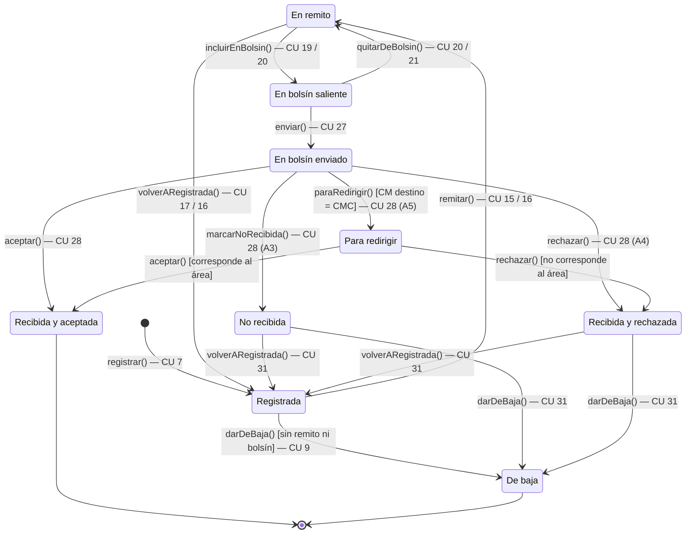

# Contexto PPAI 2026 — Bolsines · CU 28 + Máquina de estados de Documentación

> Archivo de contexto para trabajar el proyecto (diagramas, código e interfaces).
> Fuentes: ERS v1.2, Consignas, Consignas UX, Descripción del Caso v1.1 y Modelo de Dominio v11 (cátedra DSI, UTN FRC).

---

## 1. Resumen

| Ítem | Valor |
|---|---|
| Materia | Diseño de Sistemas de Información (DSI) — UTN FRC, Ing. en Sistemas |
| Trabajo | PPAI 2026 — caso **Bolsines** |
| Asignación (grupo par) | **CU 28 – Registrar recepción de bolsín** |
| Máquina de estados | **Clase Documentación** |
| Persona UX | Encargado de Bolsines (EB) |
| Tareas del proyecto | Diagramas de las vistas · ayuda con el código · interfaces (GUI) |
| Stack elegido | Java + **JavaFX 21** + Maven, aplicación de **escritorio**, VSCode en Windows |

**Dominio:** un Organismo Controlador (sede central en CABA, +80 Comisiones Médicas Jurisdiccionales y una Comisión Médica Central) envía documentación física entre comisiones médicas por correo, dentro de **bolsines** cerrados con **precinto**. El sistema registra documentación, remitos, bolsines y su trazabilidad (estado + empleado responsable en cada cambio).

### Datos de entrega (completar)
- Curso: `3K_` · Grupo: `G__` · Docente tutor: `____`
- Fechas E1 / E2: `____`
- Nombre de archivo: `PPAI2026_3K<N>_G<NroGrupo>_<E1|E2|R1|R2>_<Analisis|Arquitectura|Diseño>.pdf` (solo PDF, lo sube 1 integrante).
- Toda entrega lleva carátula completa (integrantes con legajo y mail), encabezado/pie, páginas numeradas, títulos en cada modelo. No se aceptan entregas parciales.

---

## 2. Glosario

| Término | Significado |
|---|---|
| CM / CMJ / CMC | Comisión Médica / Jurisdiccional / Central (CABA) |
| CM origen / destino | CM que envía / CM que recibe |
| EB | Encargado de Bolsines (actor principal del CU 28) |
| Bolsín | Bolsa de tela que transporta documentación hacia **una única CM destino** |
| Precinto | Cierre numerado del bolsín; si se reabre, se cambia por uno nuevo |
| Remito | Detalle de la documentación enviada; **uno por CM destino**; un bolsín puede tener varios |
| Documentación | Nº secuencial, tipo de documento, fecha de pase, CM origen, asunto, archivos |
| Tipo Documento | Expediente, dictamen, estudio médico, carta documento, etc. |

---

## 3. CU 28 — Registrar recepción de bolsín

- **Actor principal:** Encargado de Bolsines · **Actor secundario:** no aplica (incluye CU 29 → Servidor de Correo)
- **Objetivo:** registrar la recepción de un bolsín actualizando el estado de los remitos y la documentación según la situación.

### Flujo básico
1. EB selecciona la opción para registrar la recepción de un bolsín.
2. Sistema busca y muestra la CM del usuario logueado.
3. Sistema busca bolsines en estado **Enviado** cuya CM destino es la del usuario (encuentra al menos uno).
4. Sistema muestra de cada bolsín su **CM origen** y **nº de precinto**; permite seleccionar del listado o filtrar por esos datos.
5. EB selecciona un bolsín.
6. Sistema muestra, por cada remito: nº de remito; y por cada documentación: **asunto** y **tipo**.
7. Sistema muestra las 4 opciones de recepción y pide elegir una:
   1. El contenido es igual al registrado
   2. No se recibe toda la documentación
   3. Existe documentación que no corresponde al destino
   4. La documentación se debe redirigir a otra área
8. EB elige la opción 1.
9. Sistema pide confirmación.
10. EB confirma.
11. Sistema actualiza: bolsín → **Recibido en CM destino** (+ empleado responsable); remitos → **Recibido y aceptado**; documentación → **Recibida y aceptada** (+ empleado responsable).
12. Sistema **incluye CU 29 Notificar recepción de bolsín** (mail a cada CM origen con la situación de la documentación). Informa éxito. Fin.

### Flujos alternativos
| Id | Situación |
|---|---|
| A1 | No se encuentra bolsín con el nº de precinto ingresado |
| A2 | No se encuentra bolsín con la CM origen ingresada |
| A3 | EB elige "No se recibe toda la documentación" |
| A4 | EB elige "Existe documentación que no corresponde al destino" |
| A5 | EB elige "La documentación se debe redirigir a otra área" |
| A6 | EB no confirma la opción elegida |

**Obs. 1:** el EB puede cancelar el CU en cualquier momento.
**Obs. 2:** la situación de la documentación se rige por la regla de negocio "Recepción de un Bolsín en una CM Destino" (sección 4).

---

## 4. Regla de negocio — Recepción en CM destino (efecto por opción)

En todos los casos el **bolsín** pasa a **Recibido en CM destino**.

| Opción | Remito | Documentación |
|---|---|---|
| 1 · Contenido igual (flujo básico) | Recibido y aceptado | Recibida y aceptada |
| 2 · Falta documentación (A3) | **Recibido y aceptado parcial** | La que llegó → Recibida y aceptada · la que no llegó → **No recibida** (se notifica a la CM origen) |
| 3 · No corresponde al destino (A4) | *No especificado en la ERS* | La que no corresponde → **Recibida y rechazada** (vuelve al origen para asociarse a un nuevo remito) |
| 4 · Redirigir a otra área (A5) | *No especificado en la ERS* | **Para redirigir** (solo aplica si la CM destino es la **CMC**; el pase al área es interno, sin bolsín) |

**Trazabilidad:** cada cambio de estado registra fecha/hora y **empleado responsable**.

---

## 5. Máquina de estados — Documentación

### Estados (nombres según ERS)
`Registrada` · `En remito` · `En bolsín saliente` · `En bolsín enviado` · `Recibida y aceptada` · `No recibida` · `Recibida y rechazada` · `Para redirigir` · `De baja`

- **Inicial:** Registrada · **Finales:** Recibida y aceptada, De baja

### Transiciones

| Desde | Hacia | CU | Condición / nota | Método sugerido |
|---|---|---|---|---|
| (inicio) | Registrada | 7 Registrar Documentación | — | `new()` / `registrar()` |
| Registrada | En remito | 15 Generar Remito · 16 Modificar Remito (agregar) | — | `remitar()` |
| En remito | Registrada | 17 Cancelar Remito · 16 Modificar Remito (quitar) | [remito en estado creado / no asociado a bolsín] | `volverARegistrada()` |
| Registrada | De baja | 9 Eliminar Documentación | [no está en remito ni en bolsín] | `darDeBaja()` |
| En remito | En bolsín saliente | 19 Generar Bolsín · 20 Modificar Bolsín (agregar remito) | — | `incluirEnBolsin()` |
| En bolsín saliente | En remito | 20 Modificar Bolsín (quitar remito) · 21 Eliminar Bolsín | [bolsín en CM origen, no enviado] | `quitarDeBolsin()` |
| En bolsín saliente | En bolsín enviado | 27 Registrar retiro de bolsines | [bolsín cerrado → enviado] | `enviar()` |
| En bolsín enviado | Recibida y aceptada | **28** (opción 1; y doc. recibida en A3/A4) | — | `aceptar()` |
| En bolsín enviado | No recibida | **28** (A3) | [la documentación no llegó] | `marcarNoRecibida()` |
| En bolsín enviado | Recibida y rechazada | **28** (A4) | [no corresponde a la CM destino] | `rechazar()` |
| En bolsín enviado | Para redirigir | **28** (A5) | [CM destino es la CMC] | `paraRedirigir()` |
| Para redirigir | Recibida y aceptada | Recepción interna del área (sin CU numerado) | [corresponde al área] | `aceptar()` |
| Para redirigir | Recibida y rechazada | Recepción interna del área (sin CU numerado) | [no corresponde al área] | `rechazar()` |
| No recibida | Registrada | 31 Registrar Revisión de Documentación | [se reenvía] | `volverARegistrada()` |
| No recibida | De baja | 31 Registrar Revisión de Documentación | [ya no es relevante] | `darDeBaja()` |
| Recibida y rechazada | Registrada | 31 Registrar Revisión de Documentación | [se reenvía a la CM correcta] | `volverARegistrada()` |
| Recibida y rechazada | De baja | 31 Registrar Revisión de Documentación | [se da de baja] | `darDeBaja()` |

> Consigna E1: en cada transición indicar **método**, **caso de uso** y, cuando aplique, **condición de control (guarda)**.
> Los métodos sugeridos son orientativos: `setEstado()`, `aceptar()`, `remitar()` y `crearCE()` vienen del Modelo de Dominio; el resto validar contra el modelo v11 y lo trabajado en clase.
> Ojo: la RN "Contenido de un Bolsín" permite modificar el bolsín en origen **cerrado o no**, pero el objetivo del CU 20 dice "mientras no esté cerrado" → inconsistencia de la ERS, aclarar con el tutor.

### Diagrama (Mermaid)

### Estados de otras clases que toca el CU 28 (referencia)
- **Bolsín:** Creado → Cerrado → Enviado → **Recibido en CM destino** (también De baja desde Creado/Cerrado).
- **Remito:** Creado → En bolsín saliente → En bolsín enviado → **Recibido y aceptado** / **Recibido y aceptado parcial** (Cancelado desde Creado).

---

## 6. Entrega 1 — Análisis

Base de modelado: **solo** clases del Modelo de Dominio de la cátedra + la solución trabajada en clase.

1. **Vista de clases de análisis** (diagrama de clases con las clases necesarias para el escenario del CU 28).
2. **Vista de interacción** (diagrama de secuencia del flujo básico, aplicando GRASP).
3. **Máquina de estados de Documentación** (sección 5).

### Clases de análisis (propuesta)
- **Boundary:** `PantallaRegistrarRecepcionBolsin`, `InterfazServidorCorreo` (para el include del CU 29)
- **Control:** `GestorRegistrarRecepcionBolsin`
- **Entidades:** `Sesion`, `Usuario`, `Empleado`, `ComisionMedica`, `Bolsin`, `Remito`, `Documentacion`, `TipoDocumento`, `Estado`, `CambioEstado`

> Convención habitual de la cátedra: `Estado` con `ámbito` + `nombre` y métodos `esAmbitoX()` / `esNombreEstado()`; cada cambio de estado cierra el `CambioEstado` actual (`setFechaHoraFin()`) y crea uno nuevo (`crearCE()`) con fecha/hora inicio y empleado responsable. Validar nombres exactos contra el Modelo de Dominio v11 (el PDF es imagen).

### Esqueleto de la secuencia (nombres sugeridos)
| Paso | Mensajes |
|---|---|
| 1 | EB → Pantalla `opcionRegistrarRecepcionBolsin()` → `habilitarPantalla()` → Gestor `nuevaRecepcionBolsin()` |
| 2 | Gestor `buscarCMUsuarioLogueado()` → `Sesion.getUsuario()` → `Usuario.getEmpleado()` → `Empleado.getComisionMedica()` → Pantalla `mostrarCM()` |
| 3 | Gestor `buscarBolsinesEnviados()` → *`Bolsin.esEnviado()` → `Estado.esEnviado()` · `Bolsin.esDeCMDestino(cm)` |
| 4 | *`Bolsin.getCMOrigen()`, `getNroPrecinto()` → Pantalla `mostrarBolsines()`, `solicitarSeleccionBolsin()` |
| 5 | EB `tomarSeleccionBolsin()` → Gestor `tomarBolsin()` |
| 6 | Gestor `buscarRemitosYDocumentacion()` → `Bolsin.getRemitos()` → *`Remito.getNumero()`, `getDocumentacion()` → *`Documentacion.getAsunto()`, `getTipoDocumento()` → `TipoDocumento.getNombre()` |
| 7–8 | Pantalla `mostrarOpcionesRecepcion()` → EB `tomarOpcionRecepcion()` |
| 9–10 | Pantalla `solicitarConfirmacion()` → EB `tomarConfirmacion()` |
| 11 | Gestor `getFechaHoraActual()`, `buscarEstados…()` → `Bolsin.recibir()` → *`Remito.aceptar()` → *`Documentacion.aceptar()` → `CambioEstado.setFechaHoraFin()` + `crearCE()` |
| 12 | Gestor `notificarRecepcion()` → include CU 29 (`InterfazServidorCorreo`) → `finCU()` |

**GRASP:** Controlador (Gestor), Experto (cada entidad responde por sus datos/estado), Creador (`Documentacion` crea su `CambioEstado`), Bajo acoplamiento / Alta cohesión.

---

## 7. Entrega 2 — Diseño e implementación

### Rediseño
- Aplicar **un patrón GoF acordado con el tutor**. Candidato natural: **State** sobre `Documentacion` (es la MdE asignada). Alternativas a evaluar: Strategy (opciones de recepción), Observer (notificación CU 29).
- Entregar: problema que resuelve + justificación; **diagrama de clases de diseño** (tipos de datos, retornos, parámetros, visibilidad); **secuencia de diseño** de la parte rediseñada.

### Implementación
- Lenguaje: Java · UI: JavaFX 21 · Build: Maven · Tecnología: escritorio (la consigna admite Web/Escritorio; la RNF 1 de la ERS dice web → dejarlo justificado).
- Base de datos y framework de persistencia: **a definir** (la persistencia en BD es criterio de corrección).
- Arquitectura sugerida: `Pantalla` (FXML + controller JavaFX) ↔ `Gestor` ↔ entidades ↔ capa de persistencia (DAO/repositorio).

### Criterios de corrección
- Funciona el **flujo básico + al menos 2 flujos alternativos** (candidatos: A3 y A4 por su impacto en la MdE; A1/A2 son simples de mostrar).
- Consistencia con el modelado (gestor, pantalla/boundary, entidades, patrón).
- Persistencia correcta en BD.
- Defensa oral del código y del patrón; se califica ese día.

---

## 8. UX e interfaces

- Actividades en aula (persona EB): **MoodBoard**, **Mapa de empatía**, **User Journey** (antes / durante / después). Guardar fotos para la defensa.
- Diseño de GUI aplicando **patrones de diseño de interfaces**; se defiende en la presentación oral.
- Preferencias de estilo: estética moderna, interacciones como Drag & Drop.

### Pantallas del CU 28 (propuesta)
1. **Bolsines por recibir:** CM del usuario + tabla de bolsines enviados (CM origen, nº precinto) con filtros.
2. **Detalle del bolsín:** remitos → documentación (asunto, tipo).
3. **Opción de recepción:** 4 opciones; en A3/A4 marcar **qué documentación** no llegó / no corresponde (la ERS no lo detalla → decisión de diseño).
4. **Confirmación** (con opción de no confirmar → A6).
5. **Resultado** + aviso de notificación enviada (CU 29). Botón **Cancelar** siempre visible (Obs. 1).

---

## 9. Pendientes y puntos a aclarar

- [ ] Curso, nº de grupo, tutor y fechas.
- [ ] Patrón GoF acordado.
- [ ] BD y framework de persistencia.
- [ ] Estado del **remito** en A4 y A5 (la ERS no lo define).
- [ ] Cómo se selecciona la documentación afectada en A3/A4 (por documento).
- [ ] ¿La opción 4 se habilita solo si la CM del usuario es la CMC?
- [ ] Inconsistencia CU 20 vs RN sobre modificar bolsín cerrado.
- [ ] Nombres exactos de clases/atributos/métodos según Modelo de Dominio v11.

---

## 10. Fuentes del proyecto
- `2026 DSI Bolsines ERS V12.pdf` — reglas de negocio, CU 28, listado de CU, RNF.
- `2026 DSI Bolsines Consignas.pdf` — contenido de E1/E2 y criterios.
- `2026 DSI Bolsines Consignas UX.pdf` — MoodBoard, empatía, journey.
- `2026 DSI Bolsines Descripción del Caso V1.1.pdf` — dominio y glosario.
- `2026 DSI Bolsines Modelo de Dominio V 11.pdf` — diagrama de clases del dominio (imagen).
